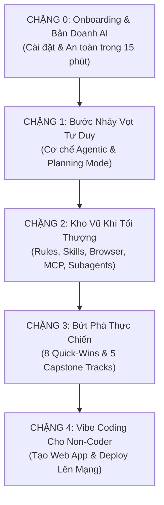

# 🎓 GIÁO TRÌNH & LỘ TRÌNH ĐÀO TẠO
## LÀM CHỦ GOOGLE ANTIGRAVITY CHO NGƯỜI KHÔNG CHUYÊN
### *(Từ Tự Động Hóa Văn Phòng Đến Tự Xây Dựng Ứng Dụng Bằng Vibe Coding)*

---

## 📌 I. TỔNG QUAN KHÓA HỌC

* **Tên chương trình:** Làm Chủ Google Antigravity & Agentic AI Thực Chiến
* **Đối tượng học viên:**
  1. **Dân Văn phòng / Quản lý / Hành chính - Nhân sự - Kế toán:** Cần giải phóng sức lao động khỏi các tác vụ Excel, Word, Email, Hóa đơn, Báo cáo thủ công lặp đi lặp lại.
  2. **Solopreneur / Người kinh doanh tự do / Khởi nghiệp:** Muốn tự động hóa vận hành, cào dữ liệu đối thủ và tự tạo Web App/Tool nội bộ phục vụ kinh doanh mà không cần thuê lập trình viên.
  3. **Sinh viên / Người chuyển ngành:** Cần trang bị tư duy AI Agentic tiên tiến nhất, làm chủ quy trình làm việc chuẩn tương lai và xây dựng đồ án thực chiến (Portfolio).
* **Phương pháp giảng dạy:**
  * **Mô hình "Bánh Mì Kẹp" (Micro-learning):** 20% Tư duy & Vấn đề thực tế ➔ 50% Agent thực thi trực tiếp trước mắt ➔ 30% Học viên thực hành tại chỗ & bẫy lỗi thường gặp.
  * **Công thức Prompt C-T-O Chuẩn Hóa:** Mọi bài thực hành đều áp dụng công thức **Context (Ngữ cảnh) ➔ Task (Nhiệm vụ nguyên tử) ➔ Output (Định dạng kết quả mong muốn)**.
  * **Tiêu chuẩn An Toàn Tuyệt Đối (Safety First):** Học cách giới hạn phạm vi làm việc của AI (Sandbox, Workspace, Permission grants) trước khi cho phép AI chạm vào dữ liệu máy tính.

---

## 🧭 II. LỘ TRÌNH 5 CHẶNG CHI TIẾT (SYLLABUS)

---

### 🚀 CHẶNG 0: Onboarding & Khởi Động "Bản Doanh AI" (Cài Đặt & An Toàn Trong 15 Phút)
> **Mục tiêu:** Phá bỏ hoàn toàn rào cản sợ công nghệ. 100% học viên cài đặt thành công, thiết lập vùng an toàn và nắm chắc "phao cứu sinh" trước khi bắt đầu.

* **Bài 0.1: Phân Biệt & Lựa Chọn — Antigravity Desktop (App 2.0) vs Antigravity IDE**
  * *Antigravity Desktop (Electron App):* Giao diện trực quan như Slack/Notion AI, canvas trò chuyện mượt mà, quản lý tác vụ nền, không hiển thị mã nguồn rắc rối. Thích hợp cho công việc văn phòng, xử lý tài liệu, điểm tin.
  * *Antigravity IDE (AI-First VS Code):* Giao diện studio chuyên sâu, hỗ trợ sửa đổi file trực tiếp, phục vụ Vibe Coding tạo trang web ở Chặng 4.
* **Bài 0.2: Cài Đặt Antigravity Desktop (Bản App 2.0) Chuẩn 1-Click**
  * Hướng dẫn tải và cài đặt trên Windows và macOS.
  * Đăng nhập tài khoản Google, chọn mô hình AI tối ưu (Gemini Flash để phản hồi tức thì, Gemini Pro để tư duy sâu).
  * Tạo thư mục Workspace đầu tiên (ví dụ: `D:/AI_Workspace`) — thiết lập ranh giới an toàn cho mọi thao tác của AI.
* **Bài 0.3: Cài Đặt Antigravity IDE & Kết Nối Workspace**
  * Tải và cài đặt Antigravity IDE.
  * Làm quen 3 khu vực tương tác cốt lõi: Sidebar Chat (hỏi đáp/lập kế hoạch), Inline Edit (`Ctrl + I` chỉnh sửa nhanh), và Terminal Sandbox.
* **Bài 0.4: "Lễ Xuất Quân" & Bộ Phao Cứu Sinh (Safety & Emergency Toolkit)**
  * Thực hiện câu lệnh đầu tiên với Agent.
  * **3 Thao tác an toàn bắt buộc ghi nhớ:**
    1. *Nút dừng khẩn cấp:* Phím tắt ngắt lệnh (`Ctrl + C` hoặc nút Kill Task) khi AI lặp vòng lặp.
    2. *Lệnh dọn dẹp bộ nhớ:* Dùng `/reset` để làm mới hoàn toàn ngữ cảnh cuộc trò chuyện.
    3. *Khôi phục dữ liệu:* Cơ chế hoàn tác và khôi phục khi AI chỉnh sửa file chưa đúng ý.

---

### 🧠 CHẶNG 1: Bước Nhảy Vọt Tư Duy & Cơ Chế Agentic AI (Nền Tảng Vững Chắc)
> **Mục tiêu:** Thoát khỏi lối mòn "Chatbot thụ động", nâng tầm học viên thành "Người quản lý AI Agent độc lập".

* **Bài 1.1: Sự Thoái Trào Của Chatbot Thụ Động & Vòng Lặp Agentic AI**
  * Phân biệt: Chatbot (chỉ phản hồi văn bản một chiều) vs Agentic AI (chu trình khép kín: *Perception ➔ Planning ➔ Action ➔ Reflection*).
* **Bài 1.2: Phương Pháp Phân Rã Nhiệm Vụ Nguyên Tử (Atomic Task Decomposition)**
  * Nguyên nhân AI "hiểu nhầm": Yêu cầu quá rộng và thiếu dữ kiện.
  * Kỹ thuật chẻ nhỏ mục tiêu lớn thành chuỗi tác vụ nguyên tử để AI thực thi chính xác 100%.
* **Bài 1.3: Token, Context Window & Quản Trị Chi Phí/Tài Nguyên**
  * Bản chất "bộ nhớ ngắn hạn" của AI.
  * Bí quyết kiểm soát ngữ cảnh: Không ném file rác làm phình Context Window, tối ưu token tiết kiệm chi phí.
* **Bài 1.4: Không Gian Làm Việc (Workspace) & Cơ Chế Terminal Sandbox**
  * Cơ chế "hàng rào an toàn" (Sandboxing): Cho phép AI chạy lệnh kiểm tra, xử lý dữ liệu mà không thể xâm phạm hệ điều hành.
* **Bài 1.5: Phân Quyền Thao Tác (Permission Policy: Ask vs Allow vs Deny)**
  * Cách cấu hình quyền: Khi nào bắt buộc Agent phải hỏi ý kiến (`request-review`), khi nào được tự động thực thi (`always-proceed`).
  * Danh sách chặn (`Denylist`): Khóa vĩnh viễn các lệnh nguy hiểm.
* **Bài 1.6: Làm Chủ Chế Độ Lập Kế Hoạch (Planning Mode & Slash Command `/plan`)**
  * Cơ chế Plan Mode: Bắt buộc Agent lên kế hoạch từng bước trước khi hành động.
  * Cách đọc, thẩm định và dùng tiếng Việt tự nhiên để yêu cầu Agent chỉnh sửa bản kế hoạch.

---

### 🛠️ CHẶNG 2: Kho Vũ Khí Tối Thượng & 6 Mini-Project Thực Chiến
> **Mục tiêu:** Nắm vững 6 tính năng đột phá của Antigravity thông qua 6 mini-project có thành phẩm ngay tại lớp.

* **Module 2.1: Rules & AGENTS.md — "Nội Quy & Sổ Tay Nhân Viên Mới"**
  * *Bài 2.1a:* Cấu trúc file `rules` và `AGENTS.md` định hình phong cách, chuẩn mực đầu ra.
  * *🛠️ Mini-Project 1:* **Trợ Lý Văn Thư Chuẩn ISO** (Agent tự kiểm tra, chuẩn hóa thể thức công văn, email theo quy định hành chính Việt Nam).
* **Module 2.2: Agent Skills — "Dạy Nghề Chuyên Biệt Cho AI"**
  * *Bài 2.2a:* Cấu tạo của một Skill chuẩn (`SKILL.md`), cách cài đặt và kích hoạt kỹ năng.
  * *🛠️ Mini-Project 2:* **Skill Trình Chiếu Slide HTML Tương Tác** (Agent tự đọc tài liệu thô và xuất file Slide HTML độc lập có hiệu ứng hoạt họa và ngăn kéo Speaker Notes).
* **Module 2.3: Browser Subagent — "Đôi Mắt Tự Động Thu Thập Thông Tin"**
  * *Bài 2.3a:* Cơ chế tự động lướt web, trích xuất thông tin bằng lệnh `/browser`.
  * *🛠️ Mini-Project 3:* **Trinh Sát Giá & Khuyến Mãi Đối Thủ** (Agent tự truy cập 3 website đối thủ, cào bảng giá và so sánh xuất file Excel cảnh báo chênh lệch).
* **Module 2.4: Model Context Protocol (MCP) — "Cổng Cắm USB Mở Rộng Giác Quan"**
  * *Bài 2.4a:* Giải mã MCP: Cầu nối giúp AI đọc và điều khiển Gmail, Google Drive, Trello, Slack.
  * *Bài 2.4b:* Hướng dẫn cấu hình MCP Servers 1-click (không cần viết code cấu hình).
  * *🛠️ Mini-Project 4:* **Trợ Lý Quét Email Khẩn & Bắn Tin Slack/Trello** (Kết nối Gmail MCP, tự quét thư có gắn cờ "Khẩn cấp", trích xuất nội dung và tạo thẻ việc trên Trello/Slack).
* **Module 2.5: Subagents & Scheduling — "Đội Ngũ Nhân Viên Song Song & Hẹn Giờ Tự Động"**
  * *Bài 2.5a:* Subagents song song: Phân công 2-3 Agent chạy ngầm cùng lúc để tăng gấp 3 tốc độ xử lý.
  * *Bài 2.5b:* Task Scheduling (`/schedule` & Cron): Đặt lịch định kỳ để Agent tự động thức dậy thực thi công việc.
  * *🛠️ Mini-Project 5:* **Tòa Soạn AI Điểm Tin Sáng Tự Động** (Agent A cào tin tức thị trường lúc 6h30, Agent B biên tập bản tin vắn và gửi vào nhóm lúc 7h00 sáng).
* **Module 2.6: Hooks & An Toàn Bảo Mật — "Lá Chắn Chống Rò Rỉ Thông Tin"**
  * *Bài 2.6a:* Cơ chế Hooks: Chốt chặn kiểm tra tự động trước và sau mỗi hành vi của Agent.
  * *🛠️ Mini-Project 6:* **Lá Chắn Bảo Mật File Nhạy Cảm** (Thiết lập rào chắn cấm tuyệt đối Agent đọc hoặc sao chép các file chứa mật khẩu, bảng lương hay thông tin CCCD).

---

### ⚡ CHẶNG 3: Bứt Phá Thực Chiến — Từ Việc Thường Nhật Đến Hệ Thống Lớn
> **Mục tiêu:** Diệt trừ triệt để công việc thủ công hàng ngày và xây dựng đồ án tốt nghiệp sát sườn với nghề nghiệp của từng học viên.

#### 📌 Phần 3A: Diệt Trừ Việc Lặp Đi Lặp Lại Hàng Ngày (8 Quick-Wins)
*(Mỗi bài được cung cấp sẵn bộ dữ liệu mẫu + 1 prompt template C-T-O thực thi ngay)*
* **Bài 3.1:** Tự động phân loại, dọn dẹp và đổi tên hàng loạt file lộn xộn trong thư mục `Downloads` theo chuẩn `YYYY-MM-DD_TenFile`.
* **Bài 3.2:** Ném 20 ảnh chụp hóa đơn/vé máy bay vào thư mục ➔ Agent tự OCR và xuất Bảng kê hoàn ứng ra Excel chuẩn công thức.
* **Bài 3.3:** Chuyển đổi bảng biểu từ ảnh scan/PDF dạng hình ảnh không copy được thành file Excel nguyên vẹn công thức tính toán.
* **Bài 3.4:** Đưa file ghi âm cuộc họp ➔ Agent tự trích xuất Biên bản họp và Lập bảng phân công công việc (Người phụ trách - Việc cần làm - Deadline).
* **Bài 3.5:** Đọc danh sách 30 khách hàng từ Excel ➔ Tự động soạn và gửi 30 email cá nhân hóa riêng biệt thông qua Gmail MCP.
* **Bài 3.6:** Tự động đối soát và tô màu cảnh báo các dòng lệch số tiền giữa 2 file Excel (Sổ phụ ngân hàng vs Sổ kế toán nội bộ).
* **Bài 3.7:** Tự động gộp dữ liệu từ 5 file báo cáo tuần định dạng khác nhau của các phòng ban thành 1 file Dashboard tổng hợp duy nhất.
* **Bài 3.8:** Tóm tắt video YouTube/Hội thảo chuyên môn 60 phút thành sơ đồ tư duy Markdown & 10 câu trắc nghiệm củng cố kiến thức.

#### 📌 Phần 3B: 5 Tuyến Đồ Án Tốt Nghiệp Chuyên Sâu (Capstones theo Ngành Nghề)
*(Học viên tự chọn 1 trong 5 Track phù hợp nhất với mục tiêu nghề nghiệp cá nhân)*
* 🎯 **Track 1 (Sinh viên / Giảng viên / Nghiên cứu sinh):**
  * *Hệ Thống Trợ Lý Nghiên Cứu & Hoàn Thiện Luận Văn Toàn Năng:* Tự động tổng quan tài liệu khoa học từ nhiều nguồn, chuẩn hóa trích dẫn APA/IEEE, và rà soát tính nhất quán của luận điểm.
* 🎯 **Track 2 (Dân Vận Hành / Quản Lý Chuỗi / Kinh Doanh):**
  * *Cỗ Máy Báo Cáo Doanh Số & Trực Quan Hóa Đa Chi Nhánh:* Hợp nhất dữ liệu bán hàng các cơ sở, phát hiện hàng tồn kho chậm luân chuyển, tự động vẽ biểu đồ trực quan hóa dữ liệu.
* 🎯 **Track 3 (Hành Chính / Nhân sự Cấp cao / Pháp Chế):**
  * *Trung Tâm Rà Soát & Thẩm Định Hợp Đồng Đa Phương:* So sánh các phiên bản hợp đồng (Diff check), phát hiện điều khoản rủi ro, đối chiếu với danh mục quy định pháp luật.
* 🎯 **Track 4 (Tuyển Dụng & Đào Tạo - HR):**
  * *Phễu Tuyển Dụng Tự Động Hóa Từ A Đến Z:* Đọc hàng loạt CV định dạng PDF/DOCX, chấm điểm độ phù hợp theo bản mô tả công việc (JD), soạn thư mời phỏng vấn tự động.
* 🎯 **Track 5 (Marketing & Bán Hàng - Sales):**
  * *Hệ Thống Radar Giám Sát Đối Thủ & Cào Leads Thị Trường:* Theo dõi biến động bài đăng truyền thông của đối thủ, quét danh sách khách hàng tiềm năng công khai và phân tích xu hướng.

---

### 💻 CHẶNG 4: Vibe Coding Cho Người Không Chuyên — Tự Tạo Ứng Dụng Nội Bộ
> **Mục tiêu:** Người hoàn toàn không biết lập trình vẫn tự tay xây dựng được Web App nội bộ chạy mượt mà trên trình duyệt và đưa lên mạng Internet miễn phí.

* **Bài 4.1: Tư Duy Vibe Coding — Giao Tiếp Bằng Ý Niệm, AI Lo Toàn Bộ Cú Pháp**
  * Nguyên lý: Con người đóng vai trò Product Owner (mô tả chức năng & thẩm định), AI đóng vai trò Full-stack Developer.
  * Kỹ thuật "chỉ điểm lỗi": Chụp ảnh màn hình hoặc copy lỗi giao diện gửi cho Agent tự fix mà không cần đọc mã code.
* **Bài 4.2: Bước Đệm 0-Cài Đặt — Tạo Dashboard Tương Tác Bằng Generative UI / HTML**
  * Yêu cầu Agent sinh một trang Dashboard đơn lẻ (HTML + Tailwind + Chart.js) hiển thị báo cáo dữ liệu.
  * Trải nghiệm "nhấp đúp là chạy": Mở trực tiếp bằng trình duyệt Chrome/Edge mà không cần cài đặt Web Server phức tạp.
* **Bài 4.3: Xây Dựng Mini Web App Hoàn Chỉnh Bằng Antigravity IDE (React & Tailwind)**
  * Để Agent tự khởi tạo môi trường hiện đại (Vite, React, icon, responsive trên di động).
  * *Thực hành thực tế (chọn 1 trong 2):*
    * App 1: Ứng dụng tra cứu nội quy & cẩm nang chính sách công ty (có ô tìm kiếm tức thì và lọc danh mục).
    * App 2: Ứng dụng đăng ký mượn thiết bị / đặt phòng họp nội bộ.
* **Bài 4.4: Đóng Gói & Triển Khai Miễn Phí Lên Internet (Deploy Trong 3 Phút)**
  * Hướng dẫn đẩy ứng dụng lên nền tảng đám mây Vercel / Netlify hoàn toàn miễn phí.
  * Nhận đường dẫn (URL) công khai chia sẻ ngay cho sếp, đồng nghiệp hoặc khách hàng trải nghiệm trên điện thoại.
* **Bài 4.5: Xây Dựng "Đế Chế AI Cá Nhân" & Lộ Trình Nâng Cấp Trọn Đời**
  * Cách lưu trữ và tái sử dụng bộ kho vũ khí (Rules, Custom Skills) cho mọi dự án tương lai.
  * Tư duy thích ứng với các bản cập nhật mô hình AI tiếp theo để luôn dẫn đầu năng suất.

---

## ⏰ III. PHÂN BỔ THỜI LƯỢNG GIẢNG DẠY THEO CÁC HÌNH THỨC

### 1. Hình thức Lớp Trực Tiếp (Live Zoom / Bootcamp 4 Tuần) — *Khuyên Dùng Nhất*
* **Thời lượng:** 8 Buổi (2 buổi/tuần, mỗi buổi 2.5 - 3 tiếng) = **Tổng cộng 20 - 24 giờ đào tạo**.
* **Tỷ lệ vàng:** 30% Giảng/Demo ➔ 50% Học viên thực hành tại lớp ➔ 20% Gỡ lỗi & Q&A.

| Buổi | Phân Bổ Nội Dung | Trọng Tâm Thực Hành & Thành Phẩm Tại Lớp |
| :---: | :--- | :--- |
| **Buổi 1** | **Chặng 0:** Cài đặt Desktop, IDE & Phao cứu sinh | 100% học viên cài đặt hoàn tất, tạo Workspace an toàn, nắm phím dừng khẩn cấp. |
| **Buổi 2** | **Chặng 1:** Tư duy Agentic, Token, Sandbox & Plan Mode | Thành thạo đọc, phản biện và duyệt bản Kế hoạch (Plan) của AI bằng tiếng Việt. |
| **Buổi 3** | **Chặng 2 (Phần 1):** Rules, Skills, Browser Subagent | Hoàn thành Mini-Project 1 (Văn thư ISO), Mini-Project 2 (Slide HTML), Mini-Project 3 (Cào giá). |
| **Buổi 4** | **Chặng 2 (Phần 2):** MCP Servers, Subagents, Lập lịch | Hoàn thành Mini-Project 4 (Email MCP), Mini-Project 5 (Tòa soạn điểm tin), Mini-Project 6 (Lá chắn bảo mật). |
| **Buổi 5** | **Chặng 3A:** Diệt trừ việc văn phòng lặp lại (8 Quick-Wins) | Xử lý thực tế tại lớp: OCR hóa đơn, bóc băng cuộc họp, đối soát 2 file Excel, gửi mail hàng loạt. |
| **Buổi 6** | **Chặng 3B:** Khởi động Đồ án Capstone theo chuyên ngành | Chia nhóm theo 5 Track chuyên ngành, Agent phân tích dữ liệu lớn và dựng khung đồ án. |
| **Buổi 7** | **Chặng 4 (Phần 1):** Vibe Coding & Dashboard HTML 0-cài đặt | Tự mô tả ý tưởng, Agent tự sinh Dashboard tương tác mở ngay trên trình duyệt Chrome. |
| **Buổi 8** | **Chặng 4 (Phần 2):** Xây dựng Mini Web App & Deploy Vercel | Đóng gói Web App, lấy link web chạy trên điện thoại + Trình chiếu Showcase + Bế giảng. |

---

### 2. Hình thức Khóa Học Video Quay Sẵn (E-Learning / Video Course)
* **Quy cách:** Chuẩn Micro-learning (8 – 15 phút / video).
* **Quy mô:** **30 – 32 video bài giảng**.
* **Tổng thời lượng video thành phẩm:** **Khoảng 7.5 – 8.5 giờ xem liên tục**.
* **Tiến độ học viên:** Tự học trong **2 – 3 tuần** (mỗi ngày 30 phút xem video và thực hành theo file mẫu).

---

### 3. Hình thức Workshop Cấp Tốc Cuối Tuần (Crash Course 2 Ngày)
* **Thời lượng:** **14 giờ thực học (2 ngày Thứ 7 & Chủ Nhật, từ 9:00 đến 17:30)**.
  * *Ngày 1 (Nền tảng & Vũ khí):* Chặng 0 (Cài đặt) + Chặng 1 (Tư duy Agentic) + Chặng 2 (Làm chủ 6 Mini-projects).
  * *Ngày 2 (Thực chiến & Vibe Coding):* Chặng 3A (Càn quét 8 Quick-wins văn phòng) + Chặng 4 (Tự làm Web App & Deploy).
  * *(Phần 3B Capstones giao làm đồ án nộp sau khóa để cấp chứng nhận tốt nghiệp)*.

---

### 4. Hình thức Đào Tạo Nội Bộ Doanh Nghiệp (In-house Corporate Training)
* **Thời lượng:** **3 buổi nửa ngày (3.5 giờ/buổi = Tổng 10.5 giờ)**.
  * *Buổi 1:* Thiết lập môi trường Antigravity an toàn, cấu hình phân quyền bảo vệ tài liệu tuyệt mật của doanh nghiệp.
  * *Buổi 2:* Ứng dụng kho vũ khí (Rules công ty, MCP đọc hòm thư/Slack công ty, Browser cào dữ liệu thị trường).
  * *Buổi 3:* Giải quyết trực tiếp các bài toán Excel báo cáo, hóa đơn, biên bản họp và hợp đồng thực tế của công ty.

---

## 🎁 IV. TÀI NGUYÊN ĐÍNH KÈM KHÓA HỌC (BONUS ASSETS)

1. **Bộ Starter-Kit Rules & AGENTS.md Mẫu:** File cấu hình chuẩn hóa phong cách làm việc cho Agent (chuẩn ISO, chuẩn tiếng Việt văn phòng, chuẩn bảo mật).
2. **Thư Viện 50+ Prompt C-T-O Thực Chiến:** Tuyển tập câu lệnh copy-paste dùng ngay cho 8 bài toán văn phòng thường nhật.
3. **Cẩm Nang Cứu Nguy 1 Trang (Cheat-sheet Card):** Tóm tắt phím tắt, cú pháp Slash command (`/plan`, `/browser`, `/schedule`, `/reset`) và hướng dẫn gỡ rối khi Agent gặp lỗi.
