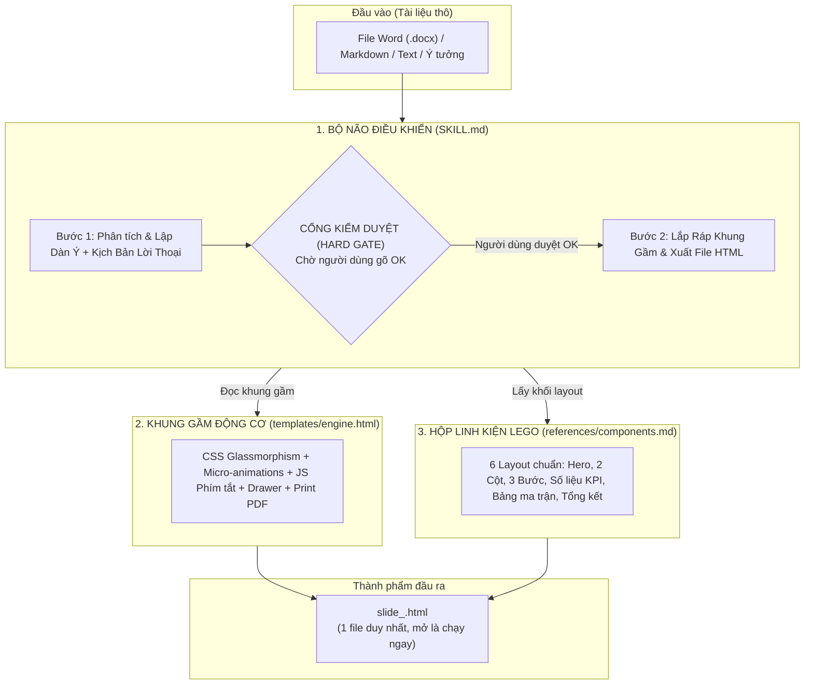

# KỸ NĂNG: TẠO SLIDE THUYẾT TRÌNH TƯƠNG TÁC CAO CẤP (TAO-SLIDE-THUYET-TRINH)
## (Starter Kit Bài 2.5 - Khóa Học Antigravity AI Cho Người Không Chuyên)

Tài liệu này định nghĩa quy trình chuẩn mực dành cho AI khi được yêu cầu chuyển đổi tài liệu thô (Word, Markdown, Text, PDF, v.v.) thành bộ slide trình chiếu tương tác hoàn chỉnh, tích hợp kịch bản lời thoại người nói (Speaker Notes Drawer), chạy độc lập 100% trên trình duyệt mà không cần cài đặt thêm bất kỳ phần mềm nào.

---

## 1. TRIẾT LÝ CỐT LÕI (CORE PHILOSOPHY)

Mọi bộ slide được sinh ra bởi skill này BẮT BUỘC tuân thủ 5 nguyên tắc vàng:

1. **Độc Lập 100% (Single-file 0-Dependency HTML):**
   - Toàn bộ sản phẩm được đóng gói trong **1 file `.html` duy nhất**.
   - Mở và chạy trực tiếp trên Chrome, Edge, Safari qua giao thức `file:///` mà không cần Node.js, Web Server hay bất kỳ thư viện bên ngoài nào.
2. **Thẩm Mỹ Hiện Đại (Glassmorphism Dark UI):**
   - Thiết kế giao diện kính mờ sang trọng trên nền tối sâu thẳm (`#090d16`), các khối thẻ (card) bo góc viền phát sáng tinh tế, chống mỏi mắt và tăng độ tập trung.
   - Sử dụng phông chữ hiện đại: `Plus Jakarta Sans` cho nội dung văn bản và `JetBrains Mono` cho nhãn mã / số liệu.
3. **Chuyển Động Vi Mô Cuốn Hút (Micro-animations):**
   - Từng phần tử con trong mỗi slide tự động trượt lên so le (Staggered fade-up) khi chuyển trang, tạo trải nghiệm thị giác chuyên nghiệp như các bài thuyết trình của Apple hay Google.
4. **Ngăn Kéo Kịch Bản Diễn Giả (Speaker Notes Drawer):**
   - Tích hợp sẵn kịch bản lời thoại người nói tự nhiên vào thuộc tính `data-notes` của từng slide.
   - Diễn giả chỉ cần nhấn phím **`S`** để trượt mở ngăn kéo lời thoại từ đáy màn hình mà khán giả không hề thấy nếu không mở.
5. **Sẵn Sàng Xuất Bản In Ấn (Print-to-PDF Ready):**
   - Tích hợp sẵn CSS `@media print` chuẩn khổ giấy A4 Landscape (nằm ngang).
   - Nhấn phím tắt **`Ctrl + P`** là có thể lưu ngay thành file PDF sắc nét để in ấn tài liệu phát tay (handout) cho người nghe.

---

## 2. KIẾN TRÚC MÔ HÌNH: "KHUNG VỎ ĐỘNG CƠ" (HYBRID TEMPLATE-ENGINE)

Để đảm bảo AI không bao giờ sinh lỗi cú pháp hay vỡ layout HTML, hệ thống vận hành theo kiến trúc 3 tầng phân tách:

- **Tầng 1 - Bộ não (`SKILL.md`):** Điều phối luồng xử lý, đảm bảo quy trình 2 bước Human-in-the-loop.
- **Tầng 2 - Khung gầm (`templates/engine.html`):** Chứa toàn bộ CSS, hệ thống phím tắt và JavaScript điều hướng đã kiểm thử an toàn.
- **Tầng 3 - Linh kiện Lego (`references/components.md`):** Cung cấp 6 mẫu HTML snippet chuẩn hóa để AI lắp ghép nội dung.

---

## 3. QUY TRÌNH VẬN HÀNH 2 BƯỚC (2-PHASE EXECUTION PROTOCOL)

Khi nhận được yêu cầu tạo slide từ tài liệu thô, AI **BẮT BUỘC** thực hiện nghiêm ngặt theo 2 bước sau:

---

### 🔹 BƯỚC 1: LẬP DÀN Ý & KỊCH BẢN LỜI THOẠI DIỄN GIẢ (SPEAKER SCRIPT)

1. **Phân tích tài liệu thô đầu vào:**
   - Đọc kỹ tài liệu mà người dùng cung cấp (đường dẫn file, nội dung dán vào chat, hoặc chủ đề yêu cầu).
   - Trích xuất cấu trúc thông tin cốt lõi:
     - Tên đề tài & mục tiêu chính.
     - Thực trạng hiện tại / Vấn đề nhức nhối (Pain points).
     - Giải pháp đột phá đề xuất.
     - Lộ trình thực hiện / Quy trình từng bước.
     - Các con số KPI / Bằng chứng minh bạch.
     - Bảng so sánh hoặc phân bổ ngân sách / nguồn lực.
     - Đúc kết & Kêu gọi hành động (Call-to-Action).
   - **Độ dài tiêu chuẩn:** Phân bổ từ **6 đến 8 slide** (tương ứng với thời lượng 10 - 15 phút thuyết trình hiệu quả).

2. **Soạn thảo Kịch bản Lời thoại Diễn giả (`data-notes`):**
   - Viết bằng văn phong nói tự nhiên, gần gũi, truyền cảm hứng (*"Kính thưa các anh chị / Chào các bạn, ở slide này..."*).
   - Tuân thủ nghiêm ngặt **công thức 3 phần** cho từng slide:
     - **Hook (Mở vấn đề):** Câu mở màn lôi cuốn, nêu câu hỏi hoặc dẫn dắt số liệu gây tò mò.
     - **Core Insight (Bản chất nội dung):** Giải thích ngắn gọn ý nghĩa trọng tâm của slide.
     - **Action / Transition (Hành động & Chuyển giao):** Đúc kết hành động cần làm hoặc kết nối mượt sang slide kế tiếp.

3. **Trình bày Bảng Dàn ý trong khung chat:**
   Hiển thị đầy đủ bảng sau để người dùng dễ dàng theo dõi và góp ý:

| STT | Eyebrow Tag | Tiêu Đề Slide | Bố Cục Component (Lego) | Ý Chính Trình Chiếu | Kịch Bản Lời Thoại Diễn Giả (`data-notes`) |
|:---:|:---|:---|:---|:---|:---|
| 01 | ⚡ KHỞI ĐỘNG | [Tiêu đề lớn dự án/bài học] | Component 1 (Hero Cover) | Thực trạng vs Mục tiêu | **[Hook]:** Chào mọi người...  **[Insight]:** Hiện nay...  **[Action]:** Hôm nay tôi xin... |
| 02 | ❌ VS ✅ | [So sánh phương án cũ vs mới] | Component 2 (Split 2 Cột) | Sai lầm cũ vs Chuẩn mới | **[Hook]:** Chúng ta hãy nhìn...  **[Insight]:** Điểm khác biệt...  **[Action]:** Vì vậy... |
| 03 | 📋 LỘ TRÌNH | [Quy trình 3 bước triển khai] | Component 3 (Grid 3 Cột) | Bước 1 ➔ Bước 2 ➔ Bước 3 | **[Hook]:** Làm thế nào để...  **[Insight]:** Với 3 bước rõ ràng...  **[Action]:** Bắt đầu ngay từ... |
| 04 | 📊 HIỆU QUẢ | [Cam kết số liệu & Chỉ số KPI] | Component 4 (KPI Stats) | 3 con số đột phá ấn tượng | **[Hook]:** Đâu là kết quả...  **[Insight]:** Con số biết nói...  **[Action]:** Đây là cơ sở để... |
| 05 | ⚖️ ĐỐI CHIẾU | [Ma trận nguồn lực / Ngân sách] | Component 5 (Bảng Ma Trận) | Phân bổ hạng mục & Đánh giá | **[Hook]:** Về mặt phân bổ...  **[Insight]:** Bảng tổng hợp cho thấy...  **[Action]:** Xin đề xuất duyệt... |
| 06 | 🎯 HÀNH ĐỘNG | [Đúc kết 3 bài học & Kêu gọi] | Component 6 (Summary & Q&A) | 3 thông điệp chốt + Liên hệ | **[Hook]:** Để tóm tắt lại...  **[Insight]:** 3 điều cần nhớ nhất...  **[Action]:** Hãy cùng bắt tay thực hiện! |

---

### 🛑 CỔNG KIỂM DUYỆT BẮT BUỘC (HARD GATE)

> [!IMPORTANT]
> **ĐÂY LÀ ĐIỂM DỪNG BẮT BUỘC (HARD GATE).**
> - Sau khi xuất bản bảng dàn ý ở Bước 1, AI **TUYỆT ĐỐI KHÔNG ĐƯỢC TỰ Ý SINH MÃ HTML HOẶC TẠO FILE**.
> - AI phải dừng lại hoàn toàn, nhường quyền kiểm soát cho người dùng duyệt nội dung.

AI kết thúc phản hồi Bước 1 bằng thông điệp thân thiện:

> 💬 *"Tôi đã phân tích tài liệu và xây dựng xong dàn ý **[Số lượng]** slide kèm kịch bản thuyết trình chi tiết từng câu từ ở trên.*  
> *Bạn có muốn điều chỉnh tiêu đề, nội dung hay giọng điệu của slide nào không?*  
> *Nếu đã ưng ý, hãy phản hồi **'OK'** hoặc **'Tiến hành'**, tôi sẽ tạo ngay file slide HTML tương tác hoàn chỉnh cho bạn nhé!"*

---

### 🔹 BƯỚC 2: XUẤT BẢN FILE HTML ĐỘC LẬP 1-CLICK

Khi người dùng gửi phản hồi xác nhận (ví dụ: `OK`, `Tiến hành`, `Đồng ý`, `Tạo file đi`, v.v.):

1. **Đọc khung gầm mẫu:**
   - Đọc nội dung file `bai-2.5-tao-slide/.agents/skills/tao-slide-thuyet-trinh/templates/engine.html`.
2. **Đọc thư viện linh kiện Lego:**
   - Tham chiếu file `bai-2.5-tao-slide/.agents/skills/tao-slide-thuyet-trinh/references/components.md` để lấy các mẫu layout phù hợp:
     - `Component 1`: Hero Cover Slide (Dành cho slide 1).
     - `Component 2`: Split Comparison 2 Cột (Cũ vs Mới, Sai vs Đúng).
     - `Component 3`: Grid 3 Cột (Quy trình 3 bước hoặc 3 trụ cột).
     - `Component 4`: KPI Stats Slide (3 con số thống kê phóng to).
     - `Component 5`: Bảng Ma Trận Đối Chiếu (Bảng dữ liệu kèm badge pills).
     - `Component 6`: Summary & Q&A Slide (3 đúc kết cốt lõi & Hộp kêu gọi hành động).
3. **Thay thế các biến Placeholder trong `engine.html`:**
   - `{{PRESENTATION_TITLE}}`: Tên bài thuyết trình (ngắn gọn, viết hoa).
   - `{{THEME_CLASS}}`: Theme giao diện màu sắc (`theme-cyber-dark`, `theme-deep-navy`, hoặc `theme-clean-light`). Mặc định dùng `theme-cyber-dark`.
   - `{{TOPIC_TAG}}`: Nhãn chuyên đề trên header (ví dụ: `⚡ ĐỀ XUẤT DỰ ÁN`, `🎯 QUY TRÌNH NỘI BỘ`).
   - `{{TOTAL_SLIDES}}`: Tổng số slide định dạng 2 chữ số (ví dụ: `06`, `07`, `08`).
   - `{{COPYRIGHT_TEXT}}`: Chú thích chân trang bản quyền (ví dụ: `© 2026 Bản quyền thuộc về Đội Ngũ Dự Án. Mọi quyền được bảo lưu.`).
   - `{{SLIDES_CONTENT}}`: Ghép toàn bộ mã HTML của các slide đã hoàn thiện.
4. **Quy tắc kỹ thuật lắp ráp nghiêm ngặt (Technical Guards):**
   - **Quy tắc class `active`:** Duy nhất Slide 01 có `class="slide active"`. Toàn bộ các slide từ số 02 trở đi chỉ có `class="slide"`.
   - **Quy tắc `data-notes`:** Mọi slide đều phải có thuộc tính `data-notes="..."` chứa toàn bộ kịch bản lời thoại đã duyệt ở Bước 1.
   - **Xử lý dấu nháy trong HTML:** Nếu trong kịch bản có trích dẫn từ ngữ, hãy dùng dấu nháy đơn (`'`) hoặc thực thể HTML `&quot;` để tránh làm hỏng cấu trúc thuộc tính `data-notes="..."`.
   - **Cân bằng thẻ HTML:** Kiểm tra kỹ lưỡng, đảm bảo mọi thẻ `
`, `<section>`, `<ul>`, `<table>` đều có thẻ đóng tương ứng.
5. **Ghi file thành phẩm:**
   - Đặt tên file theo định dạng: `slide_<ten_tai_lieu_khong_dau>.html` (hoặc `slide_demo_<ten_tai_lieu>.html`) ngay tại thư mục hiện tại của bài thực hành (`bai-2.5-tao-slide/`).
6. **Báo cáo hoàn tất và hướng dẫn trải nghiệm:**
   Sau khi tạo file, gửi thông báo chúc mừng kèm bảng tra cứu phím tắt:

> 🎉 **Tuyệt vời! File slide trình chiếu của bạn đã được khởi tạo thành công:**  
> 📁 **Đường dẫn file:** `slide_<ten_file>.html`  
> 
> **Cách mở và trải nghiệm:**  
> - Nhấp đúp chuột vào file hoặc kéo thả file vào trình duyệt Chrome/Edge/Safari.  
> 
> **Phím tắt điều khiển trên bàn phím:**  
> - <kbd>▶</kbd> hoặc <kbd>Space</kbd>: Chuyển sang slide tiếp theo  
> - <kbd>◀</kbd> hoặc <kbd>Backspace</kbd>: Quay lại slide trước  
> - <kbd>S</kbd>: Mở/Đóng **Ngăn kéo lời thoại diễn giả** từ đáy màn hình  
> - <kbd>F</kbd>: Bật/Tắt chế độ **Toàn màn hình (Fullscreen)**  
> - <kbd>Ctrl + P</kbd>: Xuất bản toàn bộ bài giảng sang file PDF khổ A4 nằm ngang  

---

## 4. HƯỚNG DẪN TÙY BIẾN CHO HỌC VIÊN (MINI CUSTOMIZATION HACKS)

Dành cho phần thực hành Pha 2 tại lớp để học viên hiểu sâu cơ chế của Agent Skill:

1. **Thay đổi phong cách Lời thoại Diễn giả:**
   - Trong Bước 1, học viên có thể yêu cầu thêm:
     - *"Hãy viết kịch bản diễn giả với phong cách dí dỏm, hài hước, dùng ngôn ngữ Gen Z."*
     - *"Hãy viết kịch bản diễn giả trang trọng, chuẩn mực dành cho cuộc họp Hội Đồng Quản Trị."*
     - *"Hãy viết kịch bản dạng kể chuyện (Storytelling) truyền cảm hứng."*
   - AI sẽ tự động điều chỉnh giọng văn trong `data-notes` cho phù hợp.

2. **Thay đổi Theme màu sắc:**
   - Thay đổi giá trị placeholder `{{THEME_CLASS}}` trong `engine.html`:
     - `theme-cyber-dark`: Gam màu tím/cyan công nghệ hiện đại (mặc định).
     - `theme-deep-navy`: Gam màu xanh biển sâu thẳm, đáng tin cậy, phù hợp doanh nghiệp tài chính/kinh doanh.
     - `theme-clean-light`: Gam màu sáng thanh lịch, nền trắng ngà, phù hợp bài giảng ban ngày hoặc in ấn.

3. **Tùy biến số lượng slide:**
   - Học viên có thể yêu cầu: *"Chỉ tạo tóm tắt 5 slide siêu ngắn"* hoặc *"Tạo bộ slide 10 slide chi tiết"*.
   - AI sẽ tự động co giãn cấu trúc nội dung và tính toán lại `{{TOTAL_SLIDES}}`.

---

## 5. BẢNG KIỂM TRA CHẤT LƯỢNG TRƯỚC KHI TRẢ KẾT QUẢ (PRE-FLIGHT CHECKLIST)

Trước khi gửi phản hồi cuối cùng cho học viên ở Bước 2, AI tự kiểm tra:
- [x] File HTML được tạo là single-file, không tham chiếu link file CSS/JS bên ngoài có thể hỏng khi mất mạng.
- [x] Đúng 1 slide mang `class="slide active"` (Slide 01).
- [x] 100% các slide đều có thuộc tính `data-notes` chứa lời thoại 3 phần (Hook -> Insight -> Action).
- [x] Các biến placeholder `{{PRESENTATION_TITLE}}`, `{{TOTAL_SLIDES}}`, `{{TOPIC_TAG}}`, `{{SLIDES_CONTENT}}` đã được thay thế trọn vẹn, không còn sót lại ký tự `{{...}}`.
- [x] Mọi thẻ HTML đóng mở cân bằng hoàn hảo, không có lỗi thụt lề hoặc đứt đoạn thẻ.
