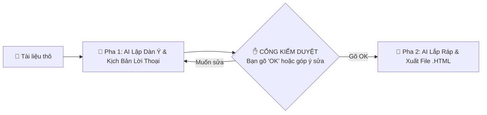

# 🎯 BÀI 2.5: BIẾN TÀI LIỆU THÀNH SLIDE THUYẾT TRÌNH CAO CẤP VỚI ANTIGRAVITY

> **Dành cho học viên khóa học Antigravity AI:** Không cần biết lập trình, không cần thiết kế Photoshop, chỉ cần 1 tài liệu thô và 1 câu lệnh tự nhiên là bạn đã có ngay một bài thuyết trình chuẩn phong cách Apple/Google với đầy đủ kịch bản lời thoại diễn giả!

---

## 🌟 1. HIỆU ỨNG "WOW" & MỤC TIÊU BÀI HỌC

Chỉ với **10 giây**, Antigravity sẽ giúp bạn:
1. **Tự động tóm tắt & cấu trúc hóa:** Biến các báo cáo dài ngoằng, file Word hay ghi chú thô sơ thành bộ slide 6-8 trang trực quan, cô đọng.
2. **Kèm sẵn kịch bản người nói (Speaker Notes):** Bạn không bao giờ phải lo quên bài khi thuyết trình vì lời thoại tự nhiên theo công thức đỉnh cao *(Hook ➔ Insight ➔ Action)* đã được tích hợp sẵn dưới đáy màn hình.
3. **Độc lập 100% không phụ thuộc Internet:** Slide được đóng gói trọn vẹn trong **1 file `.html` duy nhất**, mở trực tiếp trên trình duyệt mọi lúc mọi nơi và có thể in thành file PDF chỉ với 1 phím bấm.

---

## ⚡ 2. CÁCH SỬ DỤNG CỰC KỲ ĐƠN GIẢN (CHỈ 1 BƯỚC)

Bạn có thể kích hoạt kỹ năng tạo slide bằng một trong hai cách sau trong cửa sổ chat Antigravity:

### Cách 1: Gõ câu lệnh tự nhiên (Khuyên dùng)
Gõ trực tiếp vào ô chat:
```text
Tạo slide thuyết trình từ file tai-lieu-thuc-hanh/de-xuat-du-an.md giúp tôi
```
hoặc:
```text
/tao-slide từ file tai-lieu-thuc-hanh/quy-trinh-onboarding.md
```

### Cách 2: Kéo & Thả file (Drag & Drop)
1. Kéo thả bất kỳ file tài liệu nào của bạn (`.docx`, `.pdf`, `.md`, `.txt`) vào khung chat Antigravity.
2. Nhập thêm lời nhắn: *"Hãy biến file này thành slide thuyết trình chuyên nghiệp giúp mình"* và nhấn **Enter**.

---

## 🔄 3. QUY TRÌNH 2 GIAI ĐOẠN: BẠN LUÔN LÀ NGƯỜI LÀM CHỦ

Để đảm bảo nội dung đúng 100% ý muốn của bạn, hệ thống hoạt động theo cơ chế **2 pha an toàn**:



* **Pha 1 (Lập dàn ý & Lời thoại):** AI sẽ đọc tài liệu và đưa ra bảng tóm tắt từng slide cùng câu thoại diễn giả tương ứng. Tại đây, bạn có quyền yêu cầu: *"Đổi slide 3 ngắn lại"*, *"Thêm ví dụ thực tế"* hoặc *"Đổi giọng điệu vui vẻ hơn"*.
* **Cổng kiểm duyệt:** Chỉ khi bạn gõ **`OK`**, AI mới tiến hành lắp ráp khung gầm và xuất bản file slide.
* **Pha 2 (Xuất bản):** AI tạo ra file `slide_<ten_file>.html` nằm ngay trong thư mục bài học. Bạn chỉ cần nhấp đúp chuột để mở trên Chrome/Edge và trình chiếu ngay!

---

## ⌨️ 4. BẢNG TRA CỨU PHÍM TẮT TRÌNH CHIẾU (SHORTCUT CHEAT-SHEET)

Khi mở file slide trên trình duyệt, bạn hãy sử dụng các phím tắt siêu tiện lợi sau để điều khiển buổi thuyết trình như một chuyên gia:

| Phím tắt | Thao tác thực hiện | Công dụng thực tế |
| :---: | :--- | :--- |
| **`Space`** hoặc **`→`** / **`↓`** | **Next Slide** | Chuyển sang slide tiếp theo với hiệu ứng trượt mượt mà. |
| **`←`** hoặc **`↑`** | **Previous Slide** | Quay trở lại slide phía trước. |
| **`Home`** / **`End`** | **First / Last** | Nhảy ngay về slide đầu tiên hoặc slide tổng kết cuối cùng. |
| **`S`** | **Speaker Notes** | **Bật/Tắt ngăn kéo ghi chú diễn giả** trượt lên từ đáy màn hình chứa lời thoại gợi ý bí mật. |
| **`F`** | **Fullscreen** | Bật hoặc tắt chế độ trình chiếu toàn màn hình (không lộ thanh địa chỉ trình duyệt). |
| **`Ctrl + P`** *(hoặc `Cmd + P`)* | **Print to PDF** | **Lưu toàn bộ slide ra file PDF khổ ngang A4** chuẩn in ấn để phát tài liệu cho người nghe. |

> 💡 **Mẹo nhỏ cho diễn giả:** Trước khi trình chiếu trước đám đông, bạn hãy bấm phím **`S`** để đọc lướt kịch bản lời thoại gợi ý, sau đó bấm **`S`** lần nữa để đóng ngăn kéo lại và tự tin bắt đầu buổi nói chuyện!

---

## 🎨 5. BÍ KÍP TÙY BIẾN & "GIẢI PHẪU" SLIDE TRONG PHA 2

Bạn muốn thay đổi phong cách bài giảng cho phù hợp với từng đối tượng khán giả? Hãy thử các mẹo sau:

1. **Đổi tông giọng diễn giả (Tone of Voice):**
   * *Thuyết phục nhà đầu tư:* Thêm yêu cầu *"Viết kịch bản lời thoại với phong cách dứt khoát, sắc bén của một nhà sáng lập công nghệ."*
   * *Chia sẻ nội bộ:* Yêu cầu *"Viết kịch bản ấm áp, thân thiện, truyền cảm hứng cho nhân viên mới."*
   * *Hài hước, cuốn hút:* Yêu cầu *"Thêm yếu tố hóm hỉnh, kể chuyện dí dỏm để người nghe không buồn ngủ."*
2. **Chỉnh sửa nội dung nhanh:**
   * File `.html` xuất ra hoàn toàn là mã nguồn mở sạch sẽ. Bạn có thể mở bằng Notepad, VS Code hoặc chính Antigravity để sửa bất kỳ câu chữ nào bạn muốn chỉ trong tích tắc.

---

## 📁 6. KHO TÀI LIỆU MẪU ĐỂ BẠN THỰC HÀNH NGAY

Trong thư mục `tai-lieu-thuc-hanh/`, chúng tôi đã chuẩn bị sẵn 3 bộ tài liệu mẫu thực tế để bạn thử sức ngay tại lớp:

1. 📊 **`de-xuat-du-an.md`**: Bản đề xuất tự động hóa báo cáo Q4 của doanh nghiệp (đầy đủ số liệu KPI -65% thời gian, ngân sách 150 triệu, lộ trình 3 giai đoạn).
2. 🤝 **`quy-trinh-onboarding.md`**: Cẩm nang hội nhập nhân sự mới (hành trình Tuần 1, Tháng 1, Tháng 3 và các lưu ý văn hóa công ty).
3. 💡 **`y-tuong-khoi-nghiep.txt`**: Bản ghi chú nháp, gạch đầu dòng thô sơ về ý tưởng quán cà phê công nghệ "Vibe Coffee" (chứng minh AI có thể biến các dòng ghi chú lộn xộn thành bài pitch deck tỏa sáng).

---

**Chúc bạn có những buổi thuyết trình tự tin, cuốn hút và chinh phục mọi khán giả cùng Antigravity!** 🚀
