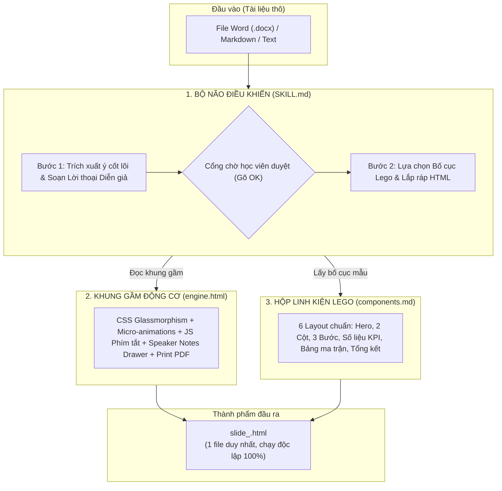

# BẢN THIẾT KẾ: SKILL TẠO SLIDE TRÌNH CHIẾU TƯƠNG TÁC CHO HỌC VIÊN NON-TECH
## (BÀI 2.5 - KHÓA HỌC LÀM CHỦ GOOGLE ANTIGRAVITY & AGENTIC AI THỰC CHIẾN)

- **Ngày ban hành:** 2026-10-13
- **Tác giả:** Đội ngũ Thiết kế Giáo trình Antigravity AI
- **Chuyên đề:** Module 2.2 — Agent Skills: "Dạy Nghề Chuyên Biệt Cho AI"
- **Định dạng thành phẩm:** Starter Kit Workspace 0-Setup (`bai-2.5-tao-slide/`)

---

## 1. TỔNG QUAN & BỐI CẢNH ĐÀO TẠO

### 1.1. Bối cảnh
Trong chương trình đào tạo *Làm Chủ Google Antigravity Cho Người Không Chuyên*, học viên (dân văn phòng, kế toán, nhân sự, kinh doanh, sinh viên) thường có tâm lý e ngại công nghệ, sợ lập trình và khó tiếp cận các khái niệm trừu tượng. 

Bài toán **"Đọc tài liệu thô ➔ Tự sinh Slide trình chiếu tương tác HTML"** được chọn làm đồ án thực hành trọng điểm (Mini-Project 2) trong Module 2.2 nhằm đạt được 2 mục tiêu:
1. **Tạo "Hiệu ứng Wow" bùng nổ:** Chỉ với 1 câu lệnh ngắn gọn, tài liệu văn bản thô sơ được chuyển hóa thành bộ slide tương tác cao cấp (Glassmorphism, hiệu ứng chuyển động, phím tắt, ngăn kéo lời thoại) chạy trực tiếp trên trình duyệt.
2. **Giải phẫu cơ chế Agent Skills dễ hiểu nhất:** Học viên hiểu bản chất `SKILL.md` đóng vai trò như "quy trình nghiệp vụ", kết hợp cùng template có sẵn để tạo ra sản phẩm hoàn chỉnh mà không cần biết viết code.

### 1.2. Triết lý thiết kế (Design Philosophy)
- **Zero-Setup & Không phụ thuộc (0-Dependency Single-file):** Không yêu cầu cài đặt Node.js, npm hay các build tool phức tạp. Mở trực tiếp bằng trình duyệt Chrome/Edge/Safari.
- **Human-in-the-Loop (Người kiểm duyệt):** AI không tự ý làm tất cả mà thực thi theo quy trình 2 bước: Lập dàn ý & Kịch bản ➔ Con người duyệt (Gõ OK) ➔ Sinh mã HTML.
- **Mô hình sư phạm 2 Pha ("Bánh mì kẹp"):** 
  - *Pha 1 (15 phút):* Trải nghiệm Wow tức thì (Thực hành thành công ngay).
  - *Pha 2 (25 phút):* Mổ xẻ giải phẫu cấu trúc và tùy biến cá nhân hóa.

---

## 2. KIẾN TRÚC TỔNG THỂ: MÔ HÌNH "KHUNG VỎ ĐỘNG CƠ" (HYBRID TEMPLATE-ENGINE)

Hệ thống được thiết kế theo nguyên lý phân tách trách nhiệm cao cấp (Separation of Concerns), phân chia thành 3 tầng:



---

## 3. CẤU TRÚC THƯ MỤC BÀI HỌC (STARTER KIT WORKSPACE)

Thư mục bài học được cấu hình chuẩn Workspace-level trong Antigravity để hệ thống tự động nhận diện Skill ngay khi học viên mở thư mục:

```text
bai-2.5-tao-slide/
├── .agents/
│   └── skills/
│       └── tao-slide-thuyet-trinh/
│           ├── SKILL.md                 # Bộ não điều khiển: Quy trình 2 bước & hướng dẫn AI
│           ├── templates/
│           │   └── engine.html          # Khung gầm động cơ: Toàn bộ CSS/JS chuẩn hóa sẵn
│           └── references/
│               └── components.md        # Linh kiện Lego: 6 khối HTML snippets chuẩn
├── tai-lieu-thuc-hanh/                  # Kho tài liệu thô mẫu cho học viên thực hành tại lớp
│   ├── de-xuat-du-an.docx               # Mẫu 1: Kế hoạch kinh doanh & Đề xuất ngân sách
│   ├── quy-trinh-onboarding.md          # Mẫu 2: Cẩm nang văn hóa & Quy trình nội bộ
│   └── y-tuong-khoi-nghiep.txt          # Mẫu 3: Ghi chú thô sơ, gạch đầu dòng
└── README.md                            # Cẩm nang 1 trang: Hướng dẫn học viên cách dùng & phím tắt
```

---

## 4. CHI TIẾT ĐẶC TẢ KỸ NĂNG (`SKILL.md`)

### 4.1. Frontmatter Metadata (Độ nhạy kích hoạt cao)
Hỗ trợ mọi câu lệnh tự nhiên của học viên:
```yaml
---
name: tao-slide-thuyet-trinh
description: "Tự động phân tích tài liệu thô (Word, PDF, Markdown, Text) và tạo slide trình chiếu HTML tương tác cao cấp độc lập. Kích hoạt khi người dùng yêu cầu: tạo slide, làm slide thuyết trình, chuyển tài liệu thành slide, biến file thành bài giảng, hoặc gõ /tao-slide."
---
```

### 4.2. Quy trình vận hành 2 Bước (2-Phase Execution Protocol)

#### 🔹 BƯỚC 1: Lập Dàn Ý & Kịch Bản Lời Thoại Diễn Giả (Speaker Script)
1. **Phân tích tài liệu thô:**
   - Trích xuất: Tiêu đề lớn, Vấn đề cốt lõi, Giải pháp đề xuất, Quy trình triển khai, Số liệu minh chứng, Hành động tiếp theo.
   - Độ dài tiêu chuẩn: **6 đến 8 slide** (thời lượng 10-15 phút trình bày).
2. **Soạn thảo lời thoại diễn giả (`data-notes`):**
   - Viết bằng văn phong nói tự nhiên, xưng hô gần gũi ("Kính thưa các anh chị / Chào các bạn, ở slide này...").
   - Tuân thủ công thức 3 phần: Hook (Mở vấn đề) ➔ Core Insight (Bản chất nội dung) ➔ Call to Action (Hành động).
3. **Hiển thị Bảng Dàn ý trong khung chat:**
   | STT | Eyebrow Tag | Tiêu Đề Slide | Bố Cục Component | Ý Chính Trình Chiếu | Kịch Bản Lời Thoại Diễn Giả (`data-notes`) |
   |:---:|:---|:---|:---|:---|:---|
   | 01 | ⚡ KHỞI ĐỘNG | [Tên đề xuất] | Cover Slide | Vấn đề vs Mục tiêu | "Chào mọi người, hôm nay tôi xin trình bày..." |
   | ... | ... | ... | ... | ... | ... |
4. **Cổng chờ phê duyệt (Hard Gate):** Dừng lại hoàn toàn và hỏi:
   > *"Tôi đã lên xong dàn ý [X] slide kèm kịch bản thuyết trình chi tiết. Bạn có muốn điều chỉnh slide nào không? Nếu đã ưng ý, hãy gõ **OK** hoặc **Tiến hành** để tôi xuất file trình chiếu ngay nhé!"*

#### 🔹 BƯỚC 2: Xuất Bản File HTML Độc Lập 1-Click
Khi nhận phản hồi xác nhận (`OK`, `Tiến hành`, `Đồng ý`):
1. Đọc nội dung từ `templates/engine.html`.
2. Thay thế các biến placeholder:
   - `{{PRESENTATION_TITLE}}`: Tiêu đề bài thuyết trình.
   - `{{THEME_CLASS}}`: Theme màu sắc (mặc định `theme-cyber-dark`, hỗ trợ `theme-deep-navy`, `theme-clean-light`).
   - `{{TOTAL_SLIDES}}`: Tổng số slide định dạng 2 chữ số (ví dụ: `07`).
   - `{{TOPIC_TAG}}`: Nhãn chuyên đề trên thanh điều hướng.
3. Ghép các khối slide từ `references/components.md` vào vị trí `{{SLIDES_CONTENT}}`.
   - Mỗi slide có cấu trúc: `<div class="slide" data-slide="X" data-notes="...">...</div>`.
   - Slide số 1 luôn có `class="slide active"`.
4. Ghi file trực tiếp ra thư mục bài học: `slide_<ten_file_khong_dau>.html`.
5. Thông báo kết quả và hướng dẫn 3 phím tắt điều khiển.

---

## 5. ĐẶC TẢ GIAO DIỆN & LINH KIỆN TƯƠNG TÁC

### 5.1. Khung gầm `engine.html`
- **Phong cách thị giác:** Glassmorphism Dark UI hiện đại (`#090d16`), card kính mờ viền phát sáng, độ tương phản cao, chống mỏi mắt.
- **Hệ thống phím tắt bàn phím:**
  - `Phím Mũi Tên Phải` / `Space` / `Enter`: Chuyển sang slide tiếp theo.
  - `Phím Mũi Tên Trái` / `Backspace`: Quay lại slide trước.
  - `Phím S`: Đóng/Mở ngăn kéo Lời thoại diễn giả (Speaker Notes Drawer) từ đáy màn hình.
  - `Phím F`: Chế độ toàn màn hình (Fullscreen).
  - `Phím Home` / `End`: Về slide đầu / slide cuối.
- **Thanh tiến độ (Progress Bar):** Dải màu gradient viền trên cùng phản ánh % tiến độ bài thuyết trình.
- **Chế độ In ấn chuẩn A4 Landscape (`Ctrl + P`):** Tự động dàn trang in ấn nằm ngang không bị mất góc, sẵn sàng xuất bản PDF tài liệu phát cho khán giả.

### 5.2. Thư viện Bố cục chuẩn `components.md` (6 Khối Lego)
1. **Hero Cover Slide:** Tiêu đề lớn kèm 2 hộp đối lập (Thực trạng ⚠️ vs Chuẩn thực chiến 🚀).
2. **Split 2 Cột (So sánh đối chiếu):** Cũ / Sai ❌ vs Mới / Tối ưu ✅.
3. **Grid 3 Cột (Quy trình 3 bước):** Thẻ nối tiếp Bước 1 ➔ Bước 2 ➔ Bước 3.
4. **KPI Stats Slide:** 3 con số thống kê phóng to ấn tượng (`-65%`, `3.5x`, `99.9%`).
5. **Comparison Matrix (Bảng ma trận):** Bảng tổng hợp kèm badge pills trạng thái.
6. **Summary & Q&A Slide:** 3 bài học đúc kết cốt lõi + Khung kêu gọi hành động / Thông tin liên hệ.

---

## 6. KỊCH BẢN GIẢNG DẠY TRÊN LỚP (GIÁO ÁN CHI TIẾT 45 - 60 PHÚT)

### 🚀 Pha 1: Trải nghiệm "Wow Effect" Tức Thì (15 Phút)
- **00:00 - 03:00:** Giảng viên đặt tình huống thực tế: *"Sếp ném file Word 10 trang lúc 4h30 chiều, yêu cầu 5h00 vào phòng họp thuyết trình. Làm thế nào?"*
- **03:00 - 06:00:** Giảng viên Live Demo trong Antigravity: Gõ câu lệnh `Tạo slide cho file tai-lieu-thuc-hanh/de-xuat-du-an.docx`. AI xuất bảng dàn ý kèm kịch bản nói. Giảng viên gõ `OK`.
- **06:00 - 08:00:** Mở file HTML trên trình duyệt: Demo phím `Space`, phím `S` bung ngăn kéo lời thoại diễn giả, phím `Ctrl + P` in PDF.
- **08:00 - 15:00:** 100% học viên mở thư mục bài học trên máy tính của mình, chọn file mẫu hoặc ném tài liệu thật vào chat và chạy thử. Tất cả đều có sản phẩm chạy được ngay.

### 🔬 Pha 2: Giải Phẫu Cấu Trúc & Tùy Biến Cá Nhân Hóa (25 Phút)
- **15:00 - 18:00:** Đặt vấn đề: *"Tại sao AI biết làm tất cả những điều thần kỳ trên mà không cần chúng ta nhắc lại từng câu lệnh?"* ➔ Định nghĩa Agent Skill.
- **18:00 - 25:00:** Mở thư mục `.agents/skills/tao-slide-thuyet-trinh/`, dùng phép ẩn dụ "Chiếc Ô Tô":
  - `SKILL.md` = Người Lái Xe (Bộ não quy trình).
  - `templates/engine.html` = Khung gầm & Động cơ (Giao diện, nút bấm, phím tắt).
  - `references/components.md` = Hộp Lego (Các mẫu bố cục).
- **25:00 - 35:00:** Thử thách thực hành nhỏ tại chỗ (Mini Hands-on):
  - Học viên mở `SKILL.md`, đổi câu prompt kịch bản thành: *"Hãy viết kịch bản diễn giả dí dỏm, hài hước"* hoặc đổi số lượng slide thành 5 slide.
  - Chạy lại lệnh ➔ Nhìn thấy AI ngay lập tức thay đổi hành vi theo ý mình. Học viên ngộ ra: *Huấn luyện AI dễ như viết một đoạn ghi chú!*

### 🎁 Tổng Kết & Ứng Dụng Hàng Ngày (5 Phút)
- Đúc kết công thức tạo mọi Skill: `Skill = Quy trình (SKILL.md) + Khung mẫu (Templates)`.
- Học viên lưu bộ công cụ về máy để áp dụng ngay vào công việc thực tế từ ngày mai.

---

## 7. TIÊU CHUẨN KIỂM ĐỊNH CHẤT LƯỢNG (QUALITY CHECKLIST)

Trước khi bàn giao thư mục Starter Kit cho học viên, bộ bài giảng phải thỏa mãn 100% các tiêu chí sau:
- [x] **Zero-dependency:** File HTML xuất ra chạy mượt mà trên Chrome, Edge, Safari khi mở trực tiếp (`file:///...`), không cần server.
- [x] **Human-in-the-loop Guard:** AI luôn dừng lại ở Bước 1 chờ phản hồi duyệt dàn ý của người dùng, không bao giờ tự ý nhảy sang Bước 2.
- [x] **Thẻ đóng mở cân bằng:** Toàn bộ thẻ `<div>`, `<section>`, `<p>` được bảo đảm đóng mở chính xác nhờ cơ chế lắp ráp an toàn từ template.
- [x] **Phím tắt hoạt động 100%:** Kiểm thử chuyển slide (Mũi tên/Space), ngăn kéo lời thoại (`S`), toàn màn hình (`F`), in ấn (`Ctrl + P`).
- [x] **Không dùng `any` hoặc cú pháp lạ:** Giữ mã nguồn thuần túy, sạch sẽ, chú thích rõ ràng bằng tiếng Việt.
