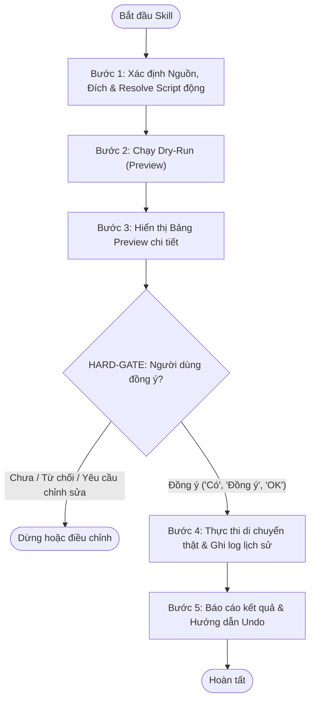

# Skill: Phân Loại & Dọn Dẹp Tệp Tin Tự Động (`phan-loai-file-tu-dong`)

Kỹ năng tự động hóa cấp hệ thống giúp quét, đọc hiểu nội dung tệp tin, phân loại thông minh vào các danh mục thư mục chuyên biệt, bảo vệ chống ghi đè dữ liệu, loại bỏ file rác hệ thống và hỗ trợ hoàn tác (Undo/Rollback) an toàn tuyệt đối.

---

## 🗺️ Quy Trình Tổng Quan



---

## ⚙️ Hướng Dẫn Thực Hiện Từng Bước:

### Bước 1: Xác Định Tham Số & Đường Dẫn Đa Nền Tảng (Cross-Platform)

#### 1.1. Thư mục Nguồn & Đích:
- **Nguồn (`<Nguon>`):** Tham số thứ 1 (Mặc định: thư mục `Downloads` của người dùng: `~/Downloads` hoặc `%USERPROFILE%\Downloads`).
- **Đích (`<Dich>`):** Tham số thứ 2 (Mặc định: `~/Documents/TaiLieu` hoặc `%USERPROFILE%\Documents\TaiLieu`).

#### 1.2. Định vị Script Động (Không dùng đường dẫn cứng):
Agent tự động xác định file script `organize_files.py` (hoặc `organize_files.js`) theo thứ tự ưu tiên:
1. **Thư mục Global User:**
   - **Windows:** `$env:USERPROFILE\.gemini\config\plugins\q-file-organizer\skills\phan-loai-file-tu-dong\scripts\organize_files.py`
   - **Linux / macOS:** `~/.gemini/config/plugins/q-file-organizer/skills/phan-loai-file-tu-dong/scripts/organize_files.py`
2. **Thư mục Workspace hiện tại:**
   - `./plugins/q-file-organizer/skills/phan-loai-file-tu-dong/scripts/organize_files.py`
3. *(Dự phòng Node.js: thay đuôi `.py` bằng `.js` nếu máy chưa cài Python)*.

#### 1.3. Lệnh thực thi tương thích hệ điều hành:
- **Trên Windows (PowerShell / CMD):** Dùng lệnh `python "<script_path>"`
- **Trên Linux / macOS (Bash / Zsh):** Dùng lệnh `python3 "<script_path>"`
- **Fallback Node.js:** Dùng lệnh `node "<script_path_js>"`

---

### Bước 2: Chạy Báo Cáo Xem Trước (Dry-Run)

Chạy command lấy dữ liệu phân tích dạng JSON:
```bash
# Windows
python "<script_path>" --source "<Nguon>" --dest "<Dich>" --dry-run

# Linux / macOS
python3 "<script_path>" --source "<Nguon>" --dest "<Dich>" --dry-run
```

*Lưu ý:*
- Script tự động bỏ qua file rác, file tạm, file hệ thống (`.DS_Store`, `Thumbs.db`, `desktop.ini`, `~$*`, `.tmp`).
- Tự động phát hiện xung đột tên (Collision) để dự phòng tên mới không bị ghi đè dữ liệu.

---

### Bước 3: Đưa Ra Bảng Báo Cáo Preview Cho Người Dùng

Trình bày bảng Markdown chuẩn hóa và chuyên nghiệp:

| STT | Tên Tệp Tin Gốc | Dung Lượng | Danh Mục Phát Hiện | Lý Do Nhận Diện | Thư Mục Đích Dự Kiến | Cảnh Báo Trùng Tên |
|:---:|---|:---:|---|---|---|:---:|
| 1 | `hoa_don_vat_t10.pdf` | 145 KB | `KeToan_TaiChinh` | Phát hiện từ khóa 'hoa don' | `Documents/TaiLieu/KeToan_TaiChinh` | Không |
| 2 | `cv_developer.pdf` | 320 KB | `NhanSu_TuyenDung` | Phát hiện từ khóa 'cv' | `Documents/TaiLieu/NhanSu_TuyenDung` | ⚠️ Đổi thành `cv_developer_1.pdf` |

Đưa ra câu hỏi xác nhận rõ ràng:
> ❓ **Bạn có đồng ý tiến hành di chuyển các tệp tin này sang các thư mục tương ứng không? (Trả lời 'Có', 'Đồng ý' hoặc 'OK' để thực hiện)**

<HARD-GATE>
TUYỆT ĐỐI KHÔNG chạy cờ `--execute` ở Bước 3. Chỉ thực thi di chuyển sau khi Người Dùng có phản hồi đồng ý rõ ràng.
</HARD-GATE>

---

### Bước 4: Thực Thi Di Chuyển Thật (Execution & Logging)

Sau khi nhận được sự đồng ý, chạy lệnh:
```bash
# Windows
python "<script_path>" --source "<Nguon>" --dest "<Dich>" --execute

# Linux / macOS
python3 "<script_path>" --source "<Nguon>" --dest "<Dich>" --execute
```

Script sẽ:
1. Di chuyển các tệp tin vào thư mục phân loại tương ứng.
2. Áp dụng cơ chế an toàn chống ghi đè (tự động đổi tên `_1`, `_2` nếu file đích đã tồn tại).
3. Xuất file lịch sử phục vụ hoàn tác tại: `<Dich>/.organize_history_<YYYYMMDD_HHMMSS>.json`.

---

### Bước 5: Báo Cáo Hoàn Tất & Hướng Dẫn Hoàn Tác (Undo)

Thông báo ngắn gọn cho người dùng:
- Tổng số tệp tin đã phân loại thành công.
- Đường dẫn file log lịch sử đã tạo.
- Hướng dẫn cú pháp hoàn tác nếu người dùng muốn khôi phục lại vị trí cũ:
  ```bash
  python "<script_path>" --undo "<duong_dan_file_history.json>"
  ```

---

## 🔄 Quy Trình Hoàn Tác (Khi người dùng yêu cầu 'Undo' / 'Rollback'):
Khi người dùng yêu cầu khôi phục hoặc rollback lần dọn dẹp trước đó:
1. Xác định file `.organize_history_*.json` gần nhất trong thư mục Đích.
2. Chạy lệnh:
   ```bash
   python "<script_path>" --undo "<duong_dan_file_history.json>"
   ```
3. Báo cáo số lượng tệp tin đã được khôi phục về lại đúng vị trí ban đầu.
