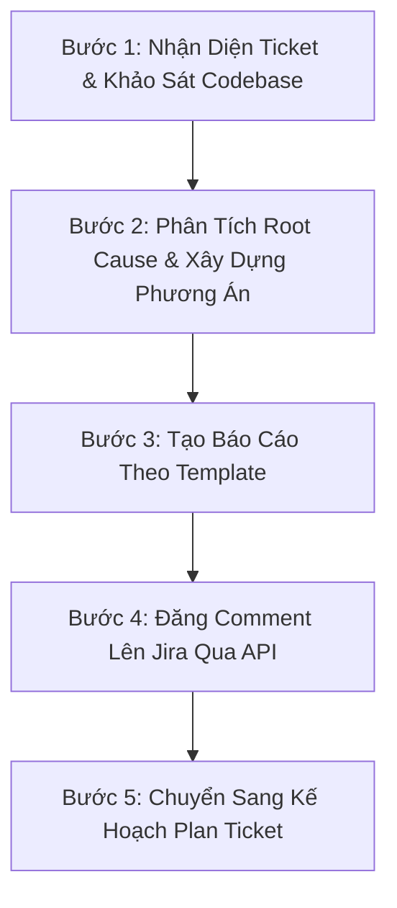

# Kỹ Năng Báo Cáo Đề Xuất Giải Pháp Kỹ Thuật (Technical Proposed Solution Report)

Kỹ năng này giúp AI tự động khảo sát codebase, phân tích nguyên nhân gốc rễ (Root Cause) và tạo bản báo cáo đề xuất các phương án kỹ thuật chuyên nghiệp, ngắn gọn, dễ hiểu từ góc nhìn của **Senior/Staff Engineer** để trình người tạo ticket, Tech Lead hoặc Manager xin ý kiến chỉ đạo.

---

## 1. Nguyên Tắc Cốt Lõi Khi Tạo Báo Cáo Giải Pháp

* **Tự động khảo sát Codebase**: Trước khi tạo báo cáo, AI bắt buộc phải dùng các công cụ tìm kiếm (`grep_search`, `view_file`) để trace luồng hoạt động thực tế (Frontend ➔ Controller ➔ Interaction ➔ Model ➔ DB) nhằm xác định chính xác Root Cause.
* **Tuân thủ Project Rules**: Luôn kiểm tra các quy tắc trong `rules/` và `storage/rules/` của dự án (ActiveInteraction gem, SOLID, Security Tenant, DB Migration Best Practices, i18n) để đảm bảo các phương án đề xuất không vi phạm tiêu chuẩn của dự án.
* **Đưa ra 2-3 Phương án song song**: Luôn đề xuất 2 đến 3 phương án giải quyết có kèm đánh giá ưu/nhược điểm, mức độ rủi ro, tác động DB Schema và chấm điểm sao (⭐ đến ⭐⭐⭐⭐⭐).
* **Nhấn mạnh vào Khuyên dùng (Recommended)**: Nêu rõ phương án tối ưu nhất với lý do thuyết phục (về bảo mật, hiệu năng, sự tối giản DB schema, tính bền vững dữ liệu).
* **Văn phong Cá nhân Chuyên nghiệp**: Xưng xưng xưng hô từ góc nhìn cá nhân ("I recommend...", "I would like to submit..."), xưng "anh/chị" hoặc tên người nhận khi viết tiếng Việt, không dùng danh xưng tập thể chung chung ("team").
* **Chuẩn hóa Jira ADF API (Zero Error)**: Đảm bảo khi gửi payload qua MCP `jira_post` / `jira_put`, cấu trúc JSON Atlassian Document Format (ADF) luôn chuẩn xác: không chứa ký tự xuống dòng `\n` trực tiếp trong node `text`, không chứa attribute thừa làm rách validation của Jira API v3.

---

## 2. Quy Trình 5 Bước Thực Hiện Tự Động



### Bước 1: Nhận Diện Ticket & Khảo Sát Codebase
1. **Trích xuất Ticket Key**:
   - Nếu user truyền URL/Key (vd: `CHQ-967`): Dùng mã này.
   - Nếu user không truyền Key: Tự động chạy lệnh shell lấy mã từ branch hiện tại: `git branch --show-current | grep -oP '[A-Z]+-\d+'`.
2. **Khảo sát Codebase**:
   - Lấy thông tin ticket từ Jira qua `jira_get` (`/rest/api/3/issue/{key}`).
   - Dùng `grep_search` và `view_file` trace luồng dữ liệu hiện tại trong `app/`.
   - Kiểm tra `db/schema.rb` để xem cấu trúc bảng hiện tại.

### Bước 2: Phân Tích Root Cause & Xây Dựng Phương Án
- Phân tích layer phát sinh lỗi thực sự (khác với nơi biểu hiện triệu chứng).
- Xây dựng 2-3 phương án kỹ thuật:
  - **Phương án 1 (Khuyên dùng - ⭐⭐⭐⭐⭐)**: Giải pháp tối ưu nhất, giải quyết root cause, bảo mật cao nhất, DB schema gọn nhẹ.
  - **Phương án 2 (⭐⭐⭐⭐)**: Giải pháp truyền thống / dự phòng.
  - **Phương án 3 (⭐⭐⭐)** (nếu có): Giải pháp ngắn hạn kèm cảnh báo rủi ro.

### Bước 3: Tạo Báo Cáo Theo Template
Sử dụng **Template Tiếng Anh (Mặc định cho Jira)** hoặc **Template Tiếng Việt (Trao đổi nội bộ/Slack)**.

### Bước 4: Đăng Comment Lên Jira API (Chuẩn ADF)
Nếu đăng lên Jira Cloud API v3 (`/rest/api/3/issue/{key}/comment`):
- Chuyển văn bản thành ADF JSON tree.
- **Quy tắc ADF an toàn**: 
  - Mỗi đoạn văn là một node `paragraph`.
  - Không chèn ký tự `\n` bên trong thuộc tính `text` của node `type: "text"`. Mỗi dòng mới phải tạo một node `paragraph` riêng biệt.
  - Định dạng bảng (table) ADF dùng `table`, `tableRow`, `tableHeader`, `tableCell` chuẩn hoặc dùng định dạng bullet list tóm tắt nếu Jira API trả lỗi `INVALID_INPUT`.

### Bước 5: Chuyển Giai Đoạn
Sau khi báo cáo/comment hoàn tất, gợi ý user sẵn sàng chạy `/plan-ticket` hoặc `/implement-ticket` khi phương án được phê duyệt.

---

## 3. Template Báo Cáo Đề Xuất Giải Pháp Kỹ Thuật (Jira Comment Template)

### 🇺🇸 Standard English Template (Default for Jira Comment)

```markdown
Due to concerns regarding **[Key Problem Area 1, e.g., Biometric Decryption Key security]** and **[Key Problem Area 2, e.g., Database Schema optimization]**, I would like to submit a technical analysis of two proposed solutions for your review and guidance on which option to proceed with.

---

### 1. Context & Root Cause
* **Issue**: [Description of the problem, symptom, and current limitation in codebase]
* **Objective**: [Clear goals and acceptance criteria to achieve]

---

### 2. Proposed Technical Solutions

#### 🔹 OPTION 1 (Recommended ⭐⭐⭐⭐⭐): [Name of Option 1]
* **Mechanism**: [How it works technically - algorithms, flows, data structures]
* **Database**: [Impact on DB Schema - e.g., NO new key columns, only 1 timestamp column]
* **Offline / Fallback Flow**: [How offline or edge cases are handled]
* **Security & Integrity**: [Security guarantees, leak resilience, data integrity]

---

#### 🔹 OPTION 2 (⭐⭐⭐⭐): [Name of Option 2]
* **Mechanism**: [How Option 2 works]
* **Database**: [Impact on DB Schema]
* **Offline / Fallback Flow**: [Fallback handling]
* **Security & Integrity**: [Security trade-offs]

---

### 3. Detailed Comparison Summary

* **OPTION 1 (Recommended)**: ⭐⭐⭐⭐⭐ (5/5). [Key advantages: Security, Schema, Resilience, Frontend compatibility].
* **OPTION 2**: ⭐⭐⭐⭐ (4/5). [Key trade-offs].

---

### 4. Recommendation & Confirmation

I recommend proceeding with **OPTION 1 ([Option 1 Short Name])** due to its **[Reason 1, e.g., superior security]**, **[Reason 2, e.g., minimal DB schema impact]**, and **[Reason 3, e.g., guarantee against key loss]**.

Could you please confirm whether to proceed with **Option 1** or **Option 2** so I can start implementing it?
```

---

### 🇻🇳 Vietnamese Template (For Internal Slack / Email / Local Discussion)

```markdown
Do vấn đề liên quan đến **[Khía cạnh kỹ thuật 1, ví dụ: Cơ chế bảo mật khóa mã hóa]** và **[Khía cạnh kỹ thuật 2, ví dụ: Tối ưu hóa Database Schema]**, em xin gửi báo cáo phân tích các phương án giải quyết để anh/chị xem xét và cho ý kiến chỉ đạo chọn phương án.

---

### 1. Bối cảnh & Nguyên nhân gốc rễ (Root Cause)
* **Vấn đề**: [Mô tả triệu chứng lỗi và hạn chế trong code hiện tại]
* **Mục tiêu**: [Mục tiêu kỹ thuật và các tiêu chí chấp nhận cần đạt được]

---

### 2. Chi Tiết Các Phương Án Kỹ Thuật Đề Xuất

#### 🔹 PHƯƠNG ÁN 1 (Khuyên dùng ⭐⭐⭐⭐⭐): [Tên Phương Án 1]
* **Cơ chế**: [Cách thức hoạt động kỹ thuật]
* **Database**: [Tác động tới DB Schema - ví dụ: Không thêm cột key, chỉ thêm 1 cột timestamp]
* **Luồng Offline / Fallback**: [Cách xử lý khi offline hoặc sự cố]
* **Bảo mật**: [Đánh giá mức độ an toàn dữ liệu và bảo mật]

---

#### 🔹 PHƯƠNG ÁN 2 (⭐⭐⭐⭐): [Tên Phương Án 2]
* **Cơ chế**: [Cách thức hoạt động]
* **Database**: [Tác động DB Schema]
* **Luồng Offline / Fallback**: [Cách xử lý]
* **Bảo mật**: [Đánh giá bảo mật]

---

### 3. Bảng So Sánh Chi Tiết Các Phương Án

| Tiêu chí | **PHƯƠNG ÁN 1 (Khuyên dùng)** <br> [Tên ngắn PA1] | **PHƯƠNG ÁN 2** <br> [Tên ngắn PA2] |
| :--- | :--- | :--- |
| **Điểm đánh giá** | **⭐⭐⭐⭐⭐ (5/5)** | ⭐⭐⭐⭐ (4/5) |
| **Bảo mật khi rò rỉ DB** | 🔒 **Tối đa**: [Đánh giá bảo mật] | ⚠️ **Trung bình**: [Đánh giá bảo mật] |
| **Tác động DB Schema** | ✅ **Rất gọn**: [Đánh giá DB] | ⚠️ [Đánh giá DB] |
| **Độ bền dữ liệu** | ✅ **100% An toàn**: [Đánh giá độ bền] | ⚠️ [Đánh giá độ bền] |
| **Tác động Frontend** | ✅ **Không ảnh hưởng**: [Đánh giá FE] | ✅ **Không ảnh hưởng**. |

---

### 4. Đề Xuất & Xin Ý Kiến Chỉ Đạo

Em đề xuất lựa chọn **PHƯƠNG ÁN 1 ([Tên ngắn PA1])** vì tính **[Lý do 1, ví dụ: bảo mật vượt trội]**, **[Lý do 2, ví dụ: DB schema gọn nhẹ nhất]** và **[Lý do 3, ví dụ: đảm bảo không rủi ro mất dữ liệu]**.

Nhờ anh/chị confirm giúp xem nên chốt triển khai theo **Phương án 1** hay **Phương án 2** để em tiến hành bắt đầu triển khai code (TDD)!
```

---

## 4. Hướng Dẫn Tái Sử Dụng & Ví Dụ Thực Tế

Khi làm việc với các ticket Jira mơ hồ hoặc cần trình báo cáo phương án kỹ thuật, bạn chỉ cần gõ lệnh:

```bash
/q-de-xuat-giai-phap-ky-thuat https://amap.atlassian.net/browse/CHQ-XXX
```
hoặc nếu đã checkout ở branch `feature/CHQ-XXX_...`, bạn chỉ cần gõ đơn giản:
```bash
/q-de-xuat-giai-phap-ky-thuat
```

AI sẽ tự động:
1. Đọc mã ticket từ tham số hoặc tên git branch hiện tại.
2. Lấy thông tin ticket Jira qua MCP `jira_get`.
3. Tracing codebase tìm Root Cause và tuân thủ các quy tắc trong `rules/` và `storage/rules/`.
4. Tạo báo cáo chuẩn Senior/Staff Engineer.
5. Chuyển đổi chuẩn ADF JSON và comment trực tiếp lên Jira ticket khi nhận lệnh xác nhận.
