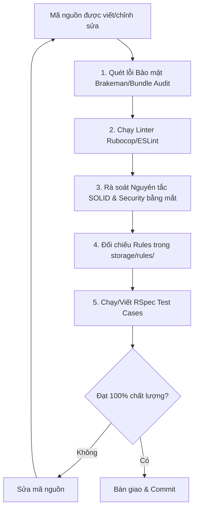

# 🛡️ Quy Trình Kiểm Tra Chất Lượng Mã Nguồn Chuyên Sâu (SOLID & Security)

Tài liệu này định nghĩa bộ quy chuẩn và quy trình tự động rà soát chất lượng mã nguồn dành cho AI Agent trước khi hoàn tất việc tạo hoặc chỉnh sửa code. Mục tiêu là đảm bảo mã nguồn viết ra không chỉ chạy đúng nghiệp vụ mà còn đạt trạng thái tối ưu nhất về kiến trúc, hiệu năng và tính bảo mật.

---

## 🧠 TƯ DUY CỐT LÕI (CORE PHILOSOPHIES)
1. **Phòng bệnh hơn chữa bệnh**: Phát hiện lỗi thiết kế (SOLID) và lỗ hổng (Security) ngay từ bước viết code trước khi chạy linter hay đẩy lên PR.
2. **Không tự giả định**: Khi phát hiện bất kỳ điểm nào không rõ ràng về mặt kiến trúc hoặc nguy cơ bảo mật, phải trình bày rõ ràng các phương án đánh đổi (tradeoffs) và xin ý kiến từ Tech Lead/User.
3. **Dao mổ tinh vi (Surgical Changes)**: Khi sửa đổi code cũ để khắc phục lỗi bảo mật hay tái cấu trúc, chỉ can thiệp đúng phạm vi cần thiết. Không làm phát sinh diff không liên quan.

---

## 🧱 1. CHUYÊN SÂU NGUYÊN TẮC SOLID

### 🔴 S - Single Responsibility Principle (Đơn Nhiệm)
*   **Triết lý**: Mỗi lớp/module/phương thức chỉ đảm nhận duy nhất một trách nhiệm và chỉ có một lý do để thay đổi.
*   **Trong Rails**:
    *   **Controller**: Chỉ làm nhiệm vụ parse params, gọi Service/Interaction và render kết quả hoặc redirect. Không chứa logic nghiệp vụ.
    *   **Model**: Chỉ định nghĩa validations, associations, scopes và callbacks tối thiểu. Không thực hiện các chuỗi thao tác ghi chép/tác động nhiều model cùng lúc.
    *   **Interaction (`app/interactions/`)**: Logic nghiệp vụ phức tạp bắt buộc phải viết bằng Gem `ActiveInteraction`. Mỗi class Interaction chỉ thực thi một use case nghiệp vụ duy nhất.
*   **Checklist kiểm tra**:
    *   [ ] Class/File có vượt quá 200 dòng không? Phương thức có vượt quá 20 dòng không? Nếu có, hãy xem xét tách nhỏ.
    *   [ ] Có logic nghiệp vụ nào đang nằm trong Controller hoặc Model không? (Nếu có → chuyển sang `ActiveInteraction`).

### 🟠 O - Open/Closed Principle (Đóng/Mở)
*   **Triết lý**: Dễ dàng mở rộng hành vi của hệ thống (viết code mới) nhưng hạn chế tối đa việc sửa đổi code cũ đã chạy ổn định.
*   **Thực thi**:
    *   Thay vì dùng chuỗi lệnh `if-elsif` hay `case-when` dài để xử lý các loại đối tượng khác nhau (ví dụ: các loại thông báo, các hình thức thanh toán), hãy sử dụng **Polymorphism (đa hình)** hoặc **Strategy Pattern**.
*   **Checklist kiểm tra**:
    *   [ ] Có đoạn code nào dùng `case class.name.to_s` hoặc check type thủ công không? (Nếu có → Đổi sang dùng duck typing hoặc định nghĩa adapter).

### 🟡 L - Liskov Substitution Principle (Thay Thế Liskov)
*   **Triết lý**: Các lớp con hoặc các module thực thi interface chung phải có khả năng thay thế hoàn toàn cho lớp cha mà không làm hỏng tính đúng đắn của ứng dụng.
*   **Thực thi**:
    *   Khi override một phương thức từ class cha hoặc kế thừa từ Base class, tuyệt đối không thay đổi signature (số lượng tham số nhận vào) và kiểu dữ liệu trả về (Return Type / Structure).
    *   Ví dụ: Nếu các Service/Interaction khác trả về kết quả dạng `outcome` có `.valid?` và `.errors`, thì service mới cũng phải giữ đúng cấu trúc này.
*   **Checklist kiểm tra**:
    *   [ ] Lớp mới kế thừa có thay đổi cấu trúc trả về hoặc ném ra exception khác hoàn toàn với lớp cha không?

### 🟢 I - Interface Segregation Principle (Phân Tách Interface)
*   **Triết lý**: Client không nên bị buộc phải phụ thuộc vào các phương thức mà nó không sử dụng.
*   **Thực thi trong Rails (ActiveInteraction)**:
    *   Khi khai báo các dependency truyền vào interaction, hãy sử dụng filter `interface` thay vì `object` để giảm sự phụ thuộc cứng vào Class cụ thể.
    *   Ví dụ: `interface :storage_service, methods: %i[upload delete]` thay vì `object :s3_storage_service`.
*   **Checklist kiểm tra**:
    *   [ ] Interaction có nhận vào một đối tượng quá lớn chỉ để dùng 1-2 phương thức của nó không? Nếu có, hãy khai báo `interface` lọc cụ thể các method cần dùng.

### 🔵 D - Dependency Inversion Principle (Đảo Ngược Phụ Thuộc)
*   **Triết lý**: Module cấp cao không được phụ thuộc trực tiếp vào module cấp thấp. Cả hai phải phụ thuộc vào Abstraction.
*   **Thực thi**:
    *   Sử dụng **Dependency Injection (DI)**. Thay vì hardcode việc khởi tạo lớp phụ thuộc bên trong phương thức (`S3Service.new.upload`), hãy truyền đối tượng dịch vụ đó thông qua constructor/parameters của Interaction.
*   **Checklist kiểm tra**:
    *   [ ] Có dòng code nào khởi tạo trực tiếp API Client hoặc Dịch vụ bên ngoài (External SDK, Redis Client, v.v.) bên trong logic xử lý chính không? (Nếu có → Inject nó từ ngoài vào).

---

## 🔒 2. CHUYÊN SÂU BẢO MẬT (SECURITY baseline)

### 🛢️ SQL Injection (SQLi)
*   **Tuyệt đối cấm**:
    *   Không nội suy chuỗi (`#{...}`) vào các phương thức truy vấn như `where`, `order`, `select`, `having`, `group`, `pluck`.
*   **Thực hành chuẩn**:
    *   Luôn dùng Hash hoặc Placeholders:
        ```ruby
        # ❌ SAI:
        User.where("name = '#{params[:name]}'")
        # ✅ ĐÚNG:
        User.where(name: params[:name])
        User.where("name = ?", params[:name])
        ```
    *   Khi sắp xếp động (Dynamic Sorting), phải whitelist cột được phép sort trước khi truyền vào `order`:
        ```ruby
        # ❌ SAI:
        Product.order(params[:sort_column])
        # ✅ ĐÚNG:
        safe_column = %w[price created_at].include?(params[:sort_column]) ? params[:sort_column] : 'created_at'
        Product.order(safe_column => params[:sort_direction] || :asc)
        ```

### 🌐 Cross-Site Scripting (XSS)
*   **Tuyệt đối cấm**:
    *   Không dùng `.html_safe` hoặc `raw` trên bất kỳ chuỗi dữ liệu nào do người dùng nhập vào.
    *   Trong Javascript, tuyệt đối không gán `element.innerHTML = user_input`.
*   **Thực hành chuẩn**:
    *   Sử dụng cơ chế escape tự động của Rails ERB.
    *   Nếu bắt buộc phải render HTML hạn chế từ user, sử dụng helper `sanitize` kết hợp whitelist tags rõ ràng:
        ```erb
        <%= sanitize user.bio, tags: %w[b i a strong], attributes: %w[href target] %>
        ```
    *   Trong Javascript, dùng `.textContent` hoặc `.innerText` thay cho `.innerHTML`.

### 👥 Insecure Direct Object Reference (IDOR)
*   **Quy tắc vàng**: Không bao giờ lấy thẳng ID từ client truyền lên để truy vấn dữ liệu toàn cục mà không kiểm tra quyền sở hữu.
*   **Thực hành chuẩn**:
    *   Luôn truy vấn thông qua quan hệ của người dùng hiện tại (current context):
        ```ruby
        # ❌ SAI (Ai cũng có thể đổi params[:id] để đọc dữ liệu người khác):
        @invoice = Invoice.find(params[:id])
        # ✅ ĐÚNG:
        @invoice = current_user.invoices.find(params[:id])
        ```
    *   Bắt buộc tích hợp Pundit policy để kiểm tra quyền ở mức server-side trên tất cả các resource.

### 🚪 Open Redirect
*   **Quy tắc**: Validate chặt chẽ các tham số redirect dạng `params[:return_to]`.
*   **Thực hành chuẩn**:
    *   Chỉ cho phép redirect tới relative path (bắt đầu bằng `/`) hoặc whitelist cụ thể domain.
        ```ruby
        # Server-side check
        def safe_redirect_path(url)
          (url.present? && url.start_with?('/')) ? url : root_path
        end
        ```
    *   Ở client-side (Javascript), cũng phải kiểm tra tương tự trước khi gán `window.location.href`.

### 📦 Strong Parameters & Mass Assignment
*   **Thực hành chuẩn**:
    *   Chỉ permit các trường dữ liệu mà user được phép sửa đổi.
    *   Không bao giờ dùng `.permit!` hoặc cho phép chỉnh sửa các trường nhạy cảm như `role`, `admin`, `tenant_id`, `created_at` từ request params.

### 🤫 Che giấu Thông tin & Thuật toán Nội bộ (Security through Obscurity)
*   Không bao giờ hiển thị trực tiếp các thông số kỹ thuật, thuật toán hoặc chỉ số nghiệp vụ nội bộ (ví dụ: biometric confidence scores, thresholds) lên UI thông báo lỗi.
*   Cung cấp thông điệp lỗi thân thiện hướng dẫn cách khắc phục cụ thể theo rule `storage/rules/error_handling_and_ui_visibility.md`.

---

## 🛠️ 3. QUY TRÌNH THỰC THI KIỂM TRA CHẤT LƯỢNG CODE

Mỗi khi chuẩn bị kết thúc việc code hoặc tạo mã mới, hãy tự động kích hoạt quy trình rà soát sau:



### Bước 1: Quét lỗi tĩnh tự động
Hãy propose chạy các lệnh kiểm tra sau trên terminal dự án (thông qua môi trường Docker nếu dự án dùng Docker):
```bash
# Quét lỗ hổng bảo mật Rails
docker compose exec worker bundle exec brakeman

# Kiểm tra các gem có CVE lỗi thời
docker compose exec worker bundle exec bundle-audit update
docker compose exec worker bundle exec bundle-audit

# Kiểm tra convention & syntax code Ruby
docker compose exec worker bundle exec rubocop -f github
```

### Bước 2: Rà soát lại thủ công bằng checklist SOLID & Security
Hãy tự đặt câu hỏi và phân tích mã nguồn vừa viết theo checklist ở mục 1 và 2.

### Bước 3: Đối chiếu với các rule dự án cụ thể
Đặc biệt lưu ý các file sau trong source:
*   `storage/rules/error_handling_and_ui_visibility.md` (Xử lý lỗi & Hiển thị UI).
*   `storage/rules/security_guidelines.md` (Hướng dẫn an toàn thông tin).
*   `storage/rules/clean-code-ruby-rules.md` (Quy chuẩn code sạch Ruby).

---

## 📝 ĐỊNH DẠNG BÁO CÁO ĐẦU RA (OUTPUT AUDIT REPORT)

Khi báo cáo kết quả kiểm tra chất lượng code cho User, hãy trình bày theo cấu trúc chuẩn hóa sau dưới dạng một markdown artifact:

```markdown
# 📊 Báo Cáo Đánh Giá Chất Lượng Mã Nguồn (SOLID & Security Audit)

## 🧱 1. Đánh giá Thiết Kế SOLID
- **S (Single Responsibility)**: [Đạt/Chưa đạt] - Giải trình chi tiết...
- **O (Open/Closed)**: [Đạt/Chưa đạt] - Giải trình chi tiết...
- **L (Liskov Substitution)**: [Đạt/Chưa đạt] - Giải trình chi tiết...
- **I (Interface Segregation)**: [Đạt/Chưa đạt] - Giải trình chi tiết...
- **D (Dependency Inversion)**: [Đạt/Chưa đạt] - Giải trình chi tiết...

## 🔒 2. Đánh giá Bảo Mật (Security Audit)
- **SQL Injection**: [An toàn/Có nguy cơ] - Mô tả cách bảo vệ...
- **Cross-Site Scripting (XSS)**: [An toàn/Có nguy cơ] - Giải thích cơ chế escape...
- **IDOR (Authorization)**: [An toàn/Có nguy cơ] - Xác nhận scope truy vấn dữ liệu...
- **Open Redirect**: [An toàn/Không có] - Xác nhận việc validate URL...
- **Che giấu thuật toán**: [Đạt/Chưa đạt] - Xác nhận lỗi thân thiện trên UI...

## ⚙️ 3. Kết quả Chạy Tool Kiểm Tra Tĩnh
- **Brakeman**: [Không phát hiện cảnh báo / Danh sách cảnh báo và hướng sửa...]
- **RuboCop**: [0 offenses / Lỗi đã được tự động sửa...]

## ⚖️ 4. Tradeoffs & Quyết Định Thiết Kế
*(Nêu ra những điểm đánh đổi về hiệu năng, bộ nhớ hoặc sự phức tạp của thiết kế và lý do chọn giải pháp hiện tại)*
```
