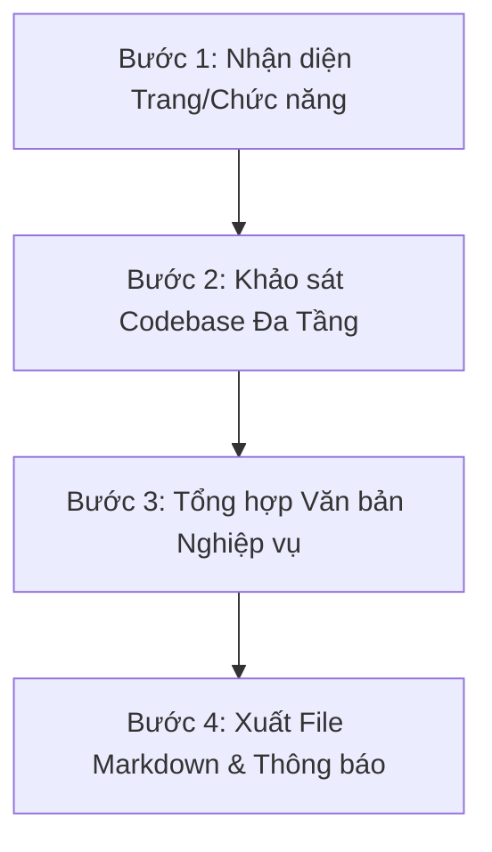

# Kỹ Năng Phân Tích Luồng Hoạt Động Chức Năng Dành Cho Project Manager (PM Flow Analyzer for NotebookLM)

Kỹ năng này giúp AI đóng vai trò là một **Senior Project Manager / Lead Product Owner** am hiểu tường tận hệ thống. AI sẽ tự động khảo sát codebase (Frontend ➔ Controller ➔ Service/Interaction ➔ Model ➔ DB ➔ Background Jobs), dịch các câu lệnh code và I18n key thành văn bản nghiệp vụ tự nhiên, sau đó xuất ra bản phân tích luồng hoạt động chuẩn hóa tại `storage/Nghiep-Vu/Trang/{Ten-Trang}/{Ten-Chuc-Nang}.md` để sẵn sàng nạp vào **NotebookLM**.

---

## 1. Tầm Nhìn & Nguyên Tắc Cốt Lõi

* **Góc nhìn Senior PM / Product Owner**: Trình bày mạch lạc, am hiểu từ mục đích kinh doanh, trải nghiệm người dùng (UX) cho đến quy định nghiệp vụ và logic ngầm.
* **Tối ưu hóa 100% cho NotebookLM**:
  * **Không dump code thuần**: Tuyệt đối không chèn các đoạn code dài (Ruby, JS, SQL). Mọi logic code phải được chuyển đổi thành **Văn bản Diễn giải Nghiệp vụ (Business Prose)** trôi chảy để giọng đọc AI của NotebookLM (Audio Overview / Podcast) đọc tự nhiên nhất.
  * **Giải mã I18n Key**: Tự động tra cứu file `config/locales/` để lấy văn bản hiển thị thực tế (ví dụ: *"Danh sách đơn hàng cần duyệt"* thay vì `t('orders.index.title')`).
  * **Định dạng Kịch bản Hỏi-Đáp (Q&A Ready)**: Tích hợp phần kịch bản thảo luận PM-Dev/QA giúp NotebookLM hỗ trợ tra cứu và học tập cực kỳ thông minh.
* **Định vị lưu trữ chuẩn hóa**: Mọi tài liệu sinh ra bắt buộc lưu tại `storage/Nghiep-Vu/Trang/{Ten-Trang}/{Ten-Chuc-Nang}.md`.

---

## 2. Quy Trình Phân Tích Codebase Đa Tầng (4 Bước)



### Bước 1: Nhận diện Trang/Chức năng
* Người dùng cung cấp tên trang, đường dẫn Controller/Action, URL hoặc tên chức năng (ví dụ: `Trang Quản lý đơn hàng`, `Admin::OrdersController#index`, `Duyệt đơn hàng`).
* Xác định tên thư mục `{Ten-Trang}` và tên file `{Ten-Chuc-Nang}.md` viết theo dạng PascalCase hoặc hyphen-case rõ ràng (ví dụ: `storage/Nghiep-Vu/Trang/Quan-Ly-Don-Hang/Duyet-Don-Hang.md`).

### Bước 2: Khảo sát Codebase Đa Tầng (Code Tracing)
AI sử dụng công cụ `grep_search` và `view_file` để quét và liên kết dữ liệu qua 5 tầng:
1. **Tầng Frontend (View & UI)**:
   * Tìm file giao diện HTML/ERB/Slim/JSX trong `app/views/` hoặc `frontend/`.
   * Tìm các sự kiện Javascript, Stimulus controller trong `app/javascript/`.
   * Trích xuất nhãn nút bấm, thông báo lỗi bằng cách tra cứu file `config/locales/vi.yml` (hoặc `en.yml`).
2. **Tầng Điều hướng & Kiểm soát (Route & Controller)**:
   * Xác định URL endpoint trong `config/routes.rb`.
   * Kiểm tra điều kiện phân quyền (Pundit, CanCanCan, Guards, `before_action`).
3. **Tầng Nghiệp vụ Chính (ActiveInteraction / Service / UseCase)**:
   * Đọc các file tương tác trong `app/interactions/`, `app/services/` hoặc `app/models/`.
   * Trích xuất toàn bộ điều kiện đầu vào (`validates`, `validate :method`), các quy tắc nghiệp vụ ngầm và luồng giao dịch (Transactions).
4. **Tầng Mô hình & Cơ sở Dữ liệu (Model & DB)**:
   * Kiểm tra quan hệ dữ liệu (`has_many`, `belongs_to`), trạng thái enum (`enum status:`), các ràng buộc DB trong `db/schema.rb`.
5. **Tầng Tác vụ Ngầm & Tích hợp (Jobs & External APIs)**:
   * Tìm các Sidekiq/ActiveJob (`app/jobs/`), Mailer (`app/mailers/`), Webhook hoặc API bên thứ ba được kích hoạt sau khi thao tác thành công.

---

## 3. Cấu Trúc File Đầu Ra Chuẩn NotebookLM (8 Mục)

Nội dung file Markdown xuất ra phải tuân thủ nghiêm ngặt 8 mục sau:

```markdown
# 📘 [Tên Chức Năng]: Luồng Hoạt Động & Quy Tắc Nghiệp Vụ

> **Trang hệ thống**: [Tên Trang / Phân khu]  
> **Tài liệu phục vụ**: Đào tạo PM/BA/QA & Nạp dữ liệu NotebookLM  
> **Thời gian cập nhật**: [YYYY-MM-DD]  

---

## 1. 🎯 Tổng Quan Chức Năng & Giá Trị Kinh Doanh
* **Mục đích kinh doanh**: Giúp giải quyết vấn đề gì cho vận hành/doanh nghiệp?
* **Bối cảnh sử dụng**: Người dùng truy cập chức năng này khi nào và từ đâu?
* **Tóm tắt luồng tổng thể**: Mô tả 2-3 câu ngắn gọn hành trình từ lúc bắt đầu đến khi hoàn tất.

---

## 2. 👥 Đối Tượng Sử Dụng & Phân Quyền Access
* **Vai trò được truy cập**: (Ví dụ: Admin, Quản lý kho, Nhân viên bán hàng).
* **Điều kiện phân quyền**: Người dùng cần có permission/role gì để thấy và thao tác?
* **Rào cản truy cập**: Chuyện gì xảy ra nếu người dùng không đủ thẩm quyền?

---

## 3. 🎬 Tổng Quan Giao Diện & Thành Phần UI
*(Đã được dịch nghĩa từ I18n - Không dùng key thô)*
* **Các vùng giao diện chính**: Thanh tìm kiếm, bảng dữ liệu, các thẻ tóm tắt stats.
* **Các nút bấm & Thao tác chính**:
  * 🔘 **[Tên Nút 1 - Nhãn thực tế]**: Mục đích và kết quả khi nhấn.
  * 🔘 **[Tên Nút 2 - Nhãn thực tế]**: Mục đích và kết quả khi nhấn.

---

## 4. 🔄 Chi Tiết Các Vi-Luồng Thao Tác (Micro-Action Flows)

### 🔹 Vi-luồng 4.1: [Tên Thao Tác 1, ví dụ: Lọc & Tìm kiếm đơn hàng]
1. **Thao tác người dùng**: Điền từ khóa, chọn trạng thái và nhấn "Tìm kiếm".
2. **Hệ thống tiếp nhận**: Nhận tham số tìm kiếm và kiểm tra tính hợp lệ.
3. **Xử lý dữ liệu**: Truy vấn danh sách phù hợp với điều kiện, sắp xếp theo thời gian mới nhất.
4. **Kết quả phản hồi**: Giao diện cập nhật danh sách mới hoặc hiển thị "Không tìm thấy kết quả".

### 🔹 Vi-luồng 4.2: [Tên Thao Tác 2, ví dụ: Duyệt đơn hàng nhanh]
1. **Thao tác người dùng**: Nhấn nút "Duyệt đơn" tại dòng tương ứng.
2. **Hệ thống kiểm tra tiền điều kiện**: Kiểm tra đơn hàng có đang ở trạng thái "Chờ duyệt" hay không.
3. **Thực thi nghiệp vụ**: Cập nhật trạng thái đơn thành "Đã duyệt", ghi nhận người duyệt và thời gian duyệt.
4. **Kích hoạt ngầm**: Gửi email thông báo cho khách hàng và đẩy bài đăng sang kho vận.
5. **Phản hồi UI**: Hộp thoại thông báo "Duyệt đơn thành công" và cập nhật badge trạng thái màu xanh.

---

## 5. 🧠 Quy Tắc Nghiệp Vụ Ngầm & Kiểm Soát Logic
* **Tiền điều kiện bắt buộc (Guards / Validations)**:
  * [Quy tắc 1: Ví dụ - Số lượng tồn kho phải lớn hơn hoặc bằng số lượng đặt].
  * [Quy tắc 2: Ví dụ - Hạn thanh toán không được quá 30 ngày].
* **Chuyển đổi trạng thái (State Machine)**:
  * `Tạo mới` ➔ `Chờ thanh toán` ➔ `Đã thanh toán` ➔ `Đang giao` ➔ `Hoàn tất`.
  * *Lưu ý*: Không thể chuyển trực tiếp từ `Chờ thanh toán` sang `Hoàn tất`.

---

## 6. 🚨 Các Kịch Bản Lỗi & Xử Lý Ngoại Lệ
* **Lỗi dữ liệu đầu vào**: Thông báo cụ thể hiển thị trên UI khi nhập sai định dạng.
* **Lỗi xung đột nghiệp vụ**: Cách xử lý khi 2 người cùng thao tác 1 bản ghi đồng thời.
* **Lỗi kết nối bên thứ 3**: Phản hồi hệ thống khi cổng thanh toán hoặc API giao hàng bị timeout.

---

## 7. ⚙️ Bối Cảnh Dữ Liệu & Tác Vụ Ngầm (Dành cho PM nắm tổng quan)
* **Các bảng dữ liệu liên quan chính**:
  * `orders` (Quản lý thông tin chung đơn hàng).
  * `order_items` (Chi tiết từng mặt hàng trong đơn).
* **Các công việc chạy ngầm (Background Jobs)**:
  * `SendOrderConfirmationEmailJob`: Chạy ngầm gửi email xác nhận.
  * `SyncInventoryJob`: Đồng bộ tồn kho sang hệ thống kế toán.

---

## 8. 💬 Kịch Bản Đào Tạo & Câu Hỏi Thường Gặp (Onboarding Q&A for NotebookLM)

* **Q1: Tại sao nút "Hủy đơn" bị ẩn đối với một số đơn hàng?**
  * *Trả lời*: Nút "Hủy đơn" chỉ hiển thị khi đơn hàng ở trạng thái "Mới tạo" hoặc "Chờ xác nhận". Khi đơn đã chuyển sang "Đang giao", quy trình bảo vệ không cho phép hủy trực tiếp trên giao diện này mà phải qua quy trình Xử lý Trả hàng.

* **Q2: Nếu khách hàng thay đổi địa chỉ sau khi đã duyệt đơn thì xử lý thế nào?**
  * *Trả lời*: Hệ thống bắt buộc người dùng phải nhấn nút "Tạm dừng giao" để chuyển đơn về trạng thái "Chờ chỉnh sửa", sau đó mới cho phép cập nhật thông tin địa chỉ mới.
```

---

## 4. Lệnh Kích Hoạch Skill & Đầu Ra

Khi bạn muốn phân tích một trang/chức năng, chỉ cần gõ:

```bash
/q-phan-tich-luong-hoat-dong-pm Trang Quản lý đơn hàng
```
Hoặc đưa đường dẫn controller / mô tả chức năng:
```bash
/q-phan-tich-luong-hoat-dong-pm Admin::OrdersController#index
```

AI sẽ thực hiện toàn bộ quy trình khảo sát code, dịch nghĩa I18n, biên soạn theo 8 mục chuẩn NotebookLM và tự động ghi vào đúng đường dẫn:
`storage/Nghiep-Vu/Trang/{Ten-Trang}/{Ten-Chuc-Nang}.md`
