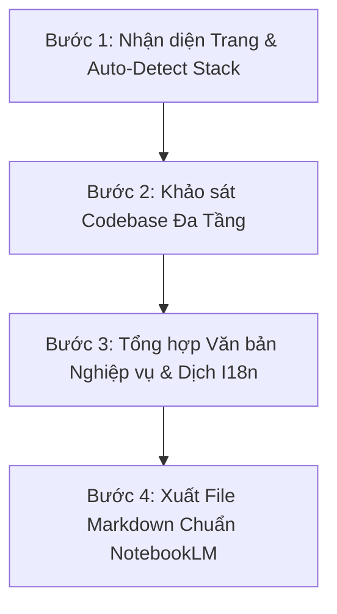

# Kỹ Năng Phân Tích Luồng Nghiệp Vụ Chức Năng Dành Cho Project Manager (PM Business Flow Analyzer for NotebookLM)

Kỹ năng này đóng vai trò là một **Senior Project Manager / Lead Product Owner** am hiểu tường tận hệ thống. AI sẽ tự động khảo sát codebase qua nhiều tầng (từ Frontend, Router/API Gateway, Business Logic/Services, Models/DB Schema đến Background Jobs/External APIs), tự động nhận diện Stack (Rails, Next.js/React, NestJS, Laravel, Django, Python, Go, Monolith hoặc Microservices), dịch các câu lệnh code và I18n key thành văn bản diễn giải nghiệp vụ tự nhiên, sau đó xuất ra bản phân tích luồng nghiệp vụ chuẩn hóa tại `storage/Nghiep-Vu/Trang/{Ten-Trang}/{Ten-Chuc-Nang}.md` (hoặc đường dẫn tùy chỉnh) để sẵn sàng nạp vào **NotebookLM**.

---

## 1. Tầm Nhìn & Nguyên Tắc Cốt Lõi

* **Góc nhìn Senior PM / Product Owner**: Trình bày mạch lạc, am hiểu từ mục đích kinh doanh, trải nghiệm người dùng (UX) cho đến quy định nghiệp vụ và logic ngầm.
* **Linh hoạt đa Stack & Kiến trúc (Stack-Agnostic)**: Tự động thích ứng với mọi công nghệ (Rails, Node.js/Next.js/NestJS, Python/Django, PHP/Laravel, Go, Java...) và mô hình kiến trúc (Monolith hoặc Decoupled Frontend + Backend API / Microservices).
* **Tối ưu hóa 100% cho NotebookLM**:
  * **Không dump code thuần**: Tuyệt đối không chèn các đoạn code dài. Mọi logic code phải được chuyển đổi thành **Văn bản Diễn giải Nghiệp vụ (Business Prose)** trôi chảy để giọng đọc AI của NotebookLM (Audio Overview / Podcast) đọc tự nhiên nhất.
  * **Giải mã I18n Key đa ngôn ngữ**: Tự động tra cứu các file i18n/locale của dự án (`config/locales/`, `public/locales/`, `lang/`, `.json`, `.yml`, `.po`) để lấy văn bản hiển thị thực tế (ví dụ: *"Danh sách đơn hàng cần duyệt"* thay vì `t('orders.index.title')` hay `t("orders.title")`).
  * **Định dạng Kịch bản Hỏi-Đáp (Q&A Ready)**: Tích hợp phần kịch bản thảo luận PM-Dev/QA giúp NotebookLM hỗ trợ tra cứu và học tập cực kỳ thông minh.
* **Metadata Chuẩn hóa (YAML Frontmatter)**: Tích hợp header metadata vào file Markdown sinh ra để các hệ thống NotebookLM, RAG hoặc Vector DB dễ dàng phân loại.
* **Định vị lưu trữ chuẩn hóa**: Mặc định lưu tại `storage/Nghiep-Vu/Trang/{Ten-Trang}/{Ten-Chuc-Nang}.md` (hoặc đường dẫn do người dùng chỉ định).

---

## 2. Quy Trình Phân Tích Codebase Đa Tầng (4 Bước)



### Bước 1: Nhận diện Trang/Chức năng & Auto-Detect Stack
* **Nhận thông tin đầu vào**: Tên trang, Controller/Action, Route API, URL hoặc tên chức năng (ví dụ: `Trang Quản lý đơn hàng`, `Admin::OrdersController#index`, `/api/v1/orders`, `Duyệt đơn hàng`).
* **Auto-Detect Stack & Architecture**:
  * Nhận diện Framework Frontend (React, Vue, ERB/Slim, Blade, Next.js, HTML/JS...).
  * Nhận diện Framework Backend (Rails, NestJS, Express, Django, Laravel, Spring Boot, Go...).
  * Nhận diện mô hình: Monolith hay Decoupled API + Frontend App.
  * Xác định thư mục lưu i18n (`config/locales/`, `public/locales/`, `locales/`, `lang/`...).
* **Xác định đường dẫn xuất file**: `{Ten-Trang}` và `{Ten-Chuc-Nang}.md` dạng PascalCase hoặc Hyphen-case (Mặc định: `storage/Nghiep-Vu/Trang/{Ten-Trang}/{Ten-Chuc-Nang}.md`).

### Bước 2: Khảo sát Codebase Đa Tầng (Multi-Layer Code Tracing)
AI sử dụng công cụ `grep_search` và `view_file` để quét và liên kết dữ liệu qua 5 tầng:
1. **Tầng Giao diện & Trải nghiệm Người dùng (Frontend & UI)**:
   * Quét giao diện (View/Page/Component/Form/Modal).
   * Quét sự kiện người dùng (Click, Submit, Filter, Search, Pagination).
   * Giải mã nhãn nút bấm, tiêu đề, thông báo lỗi từ các file locale/i18n thực tế.
2. **Tầng Điều hướng & Kiểm soát Truy cập (Routing, Controller & Security Guards)**:
   * Trích xuất URL Endpoint và HTTP Method (GET, POST, PUT, DELETE).
   * Kiểm tra điều kiện phân quyền (Role, Permission, Middleware, Guard, Policy, Scope).
3. **Tầng Logic Nghiệp vụ Chính (Business Logic / Service / Use Case Layer)**:
   * Đọc các file xử lý nghiệp vụ (`app/interactions/`, `app/services/`, `src/services/`, `use_cases/`, `domain/`...).
   * Trích xuất các điều kiện đầu vào (Validations), quy tắc kiểm tra logic ngầm và quản lý giao dịch (Database Transactions).
4. **Tầng Mô hình & Dữ liệu (Model, Schema & State Machine)**:
   * Kiểm tra mối quan hệ giữa các đối tượng dữ liệu (`has_many`, `belongs_to`, Foreign Keys, Prisma Schema, Migration/Schema DB).
   * Xác định vòng đời trạng thái (State Machine, Enums, Status transitions).
5. **Tầng Tác vụ Ngầm & Tích hợp (Async Jobs, Mailers & External APIs)**:
   * Tìm các Background Jobs (Sidekiq, BullMQ, Celery, Laravel Queue...), Mailers, Webhooks hoặc API tích hợp bên thứ ba (Cổng thanh toán, Đơn vị vận chuyển, SMS/Email Gateway) được kích hoạt.

### Bước 3: Tổng hợp Văn bản Nghiệp vụ (Business Prose Conversion)
* Chuyển toàn bộ các điều kiện code (`if/else`, `validates`, `raise error`) thành ngôn ngữ nghiệp vụ rõ ràng, tự nhiên.
* Không chèn các khối code thô (Ruby, TS/JS, SQL).

### Bước 4: Xuất File Markdown Chuẩn NotebookLM
* Ghi nội dung đã tổng hợp vào file định dạng Markdown có YAML Frontmatter chuẩn tại đường dẫn đích.

---

## 3. Cấu Trúc File Đầu Ra Chuẩn NotebookLM (YAML + 8 Mục)

Nội dung file Markdown xuất ra phải tuân thủ nghiêm ngặt cấu trúc dưới đây:

```markdown
---
title: "Luồng Hoạt Động & Quy Tắc Nghiệp Vụ - [Tên Chức Năng]"
page: "[Tên Trang / Phân khu]"
target_audience: "PM, BA, QA, Dev & NotebookLM Knowledge Base"
updated_at: "[YYYY-MM-DD]"
stack: "[Framework Frontend / Backend - e.g., Rails / React / NestJS]"
tags: ["Business Flow", "PM Docs", "NotebookLM", "[Module Name]"]
---

# 📘 [Tên Chức Năng]: Luồng Hoạt Động & Quy Tắc Nghiệp Vụ

> **Trang hệ thống**: [Tên Trang / Phân khu]  
> **Tài liệu phục vụ**: Đào tạo PM/BA/QA & Nạp dữ liệu NotebookLM (Audio Overview / Q&A)  
> **Thời gian cập nhật**: [YYYY-MM-DD]  

---

## 1. 🎯 Tổng Quan Chức Năng & Giá Trị Kinh Doanh
* **Mục đích kinh doanh**: Chức năng này giúp giải quyết bài toán gì cho doanh nghiệp/vận hành?
* **Bối cảnh sử dụng**: Người dùng truy cập chức năng này khi nào, từ điểm chạm (touchpoint) nào?
* **Tóm tắt luồng tổng thể**: Mô tả 2-3 câu ngắn gọn hành trình từ lúc bắt đầu đến khi hoàn tất.

---

## 2. 👥 Đối Tượng Sử Dụng & Phân Quyền Access
* **Vai trò được truy cập**: (Ví dụ: Admin, Quản lý kho, Khách hàng cá nhân).
* **Điều kiện phân quyền**: Người dùng cần có Role/Permission gì để thấy và thao tác?
* **Rào cản truy cập**: Chuyện gì xảy ra nếu người dùng không đủ thẩm quyền (Redirect, Thông báo lỗi...)?

---

## 3. 🎬 Tổng Quan Giao Diện & Thành Phần UI
*(Đã được dịch nghĩa hoàn toàn từ I18n - Không dùng key thô)*
* **Các vùng giao diện chính**: Thanh tìm kiếm/lọc, bảng dữ liệu, các thẻ thông số tóm tắt (Kpi Cards).
* **Các nút bấm & Thao tác chính**:
  * 🔘 **[Tên Nút 1 - Nhãn thực tế]**: Mục đích và kết quả khi nhấn.
  * 🔘 **[Tên Nút 2 - Nhãn thực tế]**: Mục đích và kết quả khi nhấn.

---

## 4. 🔄 Chi Tiết Các Vi-Luồng Thao Tác (Micro-Action Flows)

### 🔹 Vi-luồng 4.1: [Tên Thao Tác 1, ví dụ: Lọc & Tìm kiếm bản ghi]
1. **Thao tác người dùng**: Điền từ khóa, chọn trạng thái và nhấn "Tìm kiếm".
2. **Hệ thống tiếp nhận**: Nhận tham số tìm kiếm và kiểm tra tính hợp lệ.
3. **Xử lý dữ liệu**: Truy vấn danh sách phù hợp với điều kiện, sắp xếp theo thời gian mới nhất.
4. **Kết quả phản hồi**: Giao diện cập nhật danh sách mới hoặc hiển thị "Không tìm thấy kết quả".

### 🔹 Vi-luồng 4.2: [Tên Thao Tác 2, ví dụ: Phê duyệt bản ghi]
1. **Thao tác người dùng**: Nhấn nút "Duyệt" tại dòng tương ứng.
2. **Hệ thống kiểm tra tiền điều kiện**: Kiểm tra bản ghi có đang ở trạng thái hợp lệ để duyệt hay không.
3. **Thực thi nghiệp vụ**: Cập nhật trạng thái thành "Đã duyệt", ghi nhận người duyệt và thời gian duyệt.
4. **Kích hoạt ngầm**: Gửi email/thông báo và đẩy dữ liệu sang hệ thống liên quan.
5. **Phản hồi UI**: Thông báo thành công và cập nhật badge trạng thái trên giao diện.

---

## 5. 🧠 Quy Tắc Nghiệp Vụ Ngầm & Kiểm Soát Logic
* **Tiền điều kiện bắt buộc (Guards / Validations)**:
  * [Quy tắc 1: Điều kiện về dữ liệu hợp lệ].
  * [Quy tắc 2: Điều kiện ràng buộc thời gian hoặc số lượng].
* **Chuyển đổi trạng thái (State Machine)**:
  * `Trạng thái A` ➔ `Trạng thái B` ➔ `Trạng thái C`.
  * *Lưu ý*: Các chuyển đổi không hợp lệ bị cấm.

---

## 6. 🚨 Các Kịch Bản Lỗi & Xử Lý Ngoại Lệ
* **Lỗi dữ liệu đầu vào**: Thông báo cụ thể hiển thị trên UI khi người dùng nhập thông tin không đúng quy định.
* **Lỗi xung đột nghiệp vụ**: Cách xử lý khi 2 người dùng cùng thao tác 1 bản ghi đồng thời.
* **Lỗi kết nối bên thứ 3**: Phản hồi hệ thống khi dịch vụ ngoài (Thanh toán, Đơn vị vận chuyển, Email) bị gián đoạn hoặc timeout.

---

## 7. ⚙️ Bối Cảnh Dữ Liệu & Tác Vụ Ngầm (Dành cho PM nắm tổng quan)
* **Các thực thể dữ liệu chính**:
  * Entity 1 (Lưu giữ thông tin chính).
  * Entity 2 (Lưu giữ chi tiết/lịch sử).
* **Các công việc chạy ngầm & Tích hợp (Background Jobs & Services)**:
  * Job 1: Xử lý đồng bộ hoặc gửi thông báo.
  * Job 2: Tác vụ dọn dẹp hoặc cập nhật định kỳ.

---

## 8. 💬 Kịch Bản Đào Tạo & Câu Hỏi Thường Gặp (Onboarding Q&A for NotebookLM)

* **Q1: Tại sao một thao tác bị ẩn hoặc không thể nhấn được đối với một số bản ghi?**
  * *Trả lời*: Nguyên nhân nghiệp vụ và điều kiện để nút thao tác hiển thị trở lại.

* **Q2: Trường hợp xảy ra lỗi ngoại lệ thì quy trình khắc phục như thế nào?**
  * *Trả lời*: Hướng dẫn các bước xử lý hoặc quy trình hỗ trợ người dùng.
```

---

## 4. Lệnh Kích Hoạch Skill & Ví Dụ Sử Dụng

Khi muốn phân tích một trang/chức năng, gõ:

```bash
/q-phan-tich-luong-nghiep-vu Trang Quản lý đơn hàng
```
Hoặc chỉ định file Controller / Endpoint API / Mô tả:
```bash
/q-phan-tich-luong-nghiep-vu Admin::OrdersController#index
```
```bash
/q-phan-tich-luong-nghiep-vu src/modules/orders/orders.controller.ts
```

AI sẽ tự động khảo sát codebase, xác định stack, dịch nghĩa i18n, biên soạn theo 8 mục chuẩn NotebookLM và tự động lưu vào:
`storage/Nghiep-Vu/Trang/{Ten-Trang}/{Ten-Chuc-Nang}.md`
