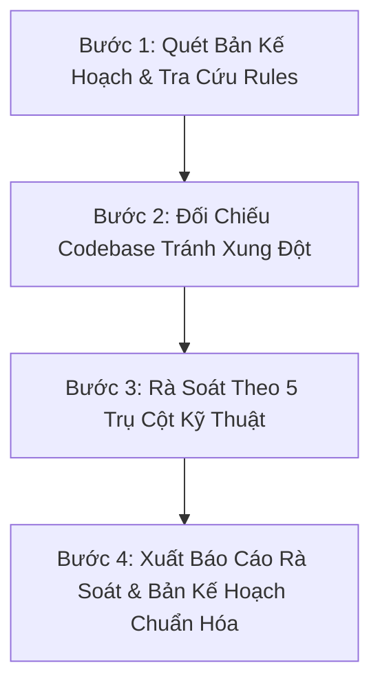

# Kỹ Năng Rà Soát & Chuẩn Hóa Kế Hoạch Triển Khai (Review Implementation Plan)

Kỹ năng này giúp AI tự động kiểm tra, đánh giá và tinh chỉnh kế hoạch triển khai kỹ thuật (**Implementation Plan / Plan Ticket**) trước khi tiến hành viết code (TDD). Kỹ năng đảm bảo kế hoạch tuân thủ nghiêm ngặt các quy tắc dự án (**Global Rules**, **Project Rules trong `storage/rules/`, `rules/`, `AGENTS.md`**), chuẩn hóa cách đặt tên (Naming Conventions), kiến trúc SOLID, An toàn thông tin (Security) và Xử lý triệt để các góc cạnh (Edge Cases).

---

## 1. Mục Tiêu & Nguyên Tắc Rà Soát

Trước khi viết bất kỳ dòng code nào, kế hoạch triển khai phải vượt qua 5 trụ cột rà soát:

1. **Chuẩn Hóa Đặt Tên (Naming Conventions & Intuitiveness)**:
   - Đặt tên File, Class, Method, Variable, DB Column, Route API, Stimulus Controller dễ hiểu, tường minh, chuẩn ngữ pháp tiếng Anh.
   - Tránh xung đột tên với các thành phần sẵn có trong codebase.
   - Phù hợp với convention của Rails, ActiveInteraction, RESTful API và Stimulus JS.
2. **Tuân Thủ Quy Tắc Dự Án (Rules Compliance)**:
   - Đọc và áp dụng quy tắc từ:
     - Global Rules: `/home/tranquyet/.agents/rules`, `/home/tranquyet/.gemini/config/plugins/chasqui/rules/`
     - Project Rules: `storage/rules/`, `rules/`, `.agent/rules/`, `AGENTS.md`
   - *Bắt buộc*: Logic nghiệp vụ Service Layer phải viết bằng `ActiveInteraction` gem đặt tại `app/interactions/` (tuyệt đối không dùng `app/services/`).
   - *Bắt buộc*: Không hardcode chuỗi UI trong Views hoặc JavaScript (I18n 100%).
3. **Phân Tích Kiến Trúc & SOLID (Clean Architecture)**:
   - Đảm bảo Single Responsibility Principle (SRP): Mỗi class/controller chỉ làm 1 nhiệm vụ.
   - Phân định rõ phase Validation (`validates`, `before_validation`) với phase Execution (`execute`) trong ActiveInteraction.
4. **An Toàn & Xử Lý Edge Case (Security & Robustness)**:
   - Kiểm tra rủi ro mất dữ liệu, rớt mạng, lệch trạng thái giữa Client-Server (ví dụ: HTTP sync fallback, WebSocket disconnection).
   - Phân quyền chặt chẽ theo `current_user` / Tenant scope.
5. **Quy Trình TDD & Kiểm Thử (Test-Driven Development Roadmap)**:
   - Các task được chia nhỏ tuần tự theo luồng TDD (Viết Red test ➔ Green implementation ➔ Refactor).
   - Mỗi file thay đổi đều có file test tương ứng trong `test/`.

---

## 2. Quy Trình Rà Soát 4 Bước



### Bước 1: Quét Bản Kế Hoạch & Tra Cứu Rules
1. **Đọc File Plan**: Mở file kế hoạch triển khai (thường nằm ở `docs/skills/plans/YYYY-MM-DD-*.md` hoặc nội dung Plan Mode).
2. **Đọc Quy Tắc Dự Án**: Dùng `view_file` / `grep_search` quét toàn bộ các file trong:
   - `storage/rules/` (như `javascript-frontend-rules.md`, `ruby-rails-rules.md`, `security-tenant-rules.md`)
   - `storage/rules/`
   - `AGENTS.md`
   - `rules/` và `.agent/rules/`

### Bước 2: Đối Chiếu Codebase Tránh Xung Đột (Collision Check)
1. **Quét Controller & Helper sẵn có**:
   - Dùng `grep_search` kiểm tra xem tên Stimulus Controller hay ActiveInteraction Class đề xuất trong Plan có bị trùng tên hoặc trùng chức năng với file cũ hay không (Ví dụ: tránh nhồi thêm logic auto-sync ngầm vào `biometric_sync_controller.js` vốn dành cho PIN Backup Vault).
2. **Check Routes & DB Schema**:
   - Kiểm tra `config/routes.rb` và `db/schema.rb` để đảm bảo tên endpoint API, tên cột migration không bị trùng hoặc trái convention hiện tại.

### Bước 3: Rà Soát Theo 5 Trụ Cột Kỹ Thuật (Detail Auditing)

#### 🎯 Pillar 1: Naming Review (Đặt tên)
- **Model & DB**:
  - Cột datetime nên kết thúc bằng `_at` (ví dụ: `synced_at`, `verified_at`).
  - Scope mang ý nghĩa trạng thái rõ ràng: `scope :pending_sync, -> { where(synced_at: nil) }`.
  - Prefer **Instance Method** cho thao tác trên đối tượng cụ thể (`biometric.derive_encryption_key`) thay vì Class Method bắt truyền lại IDs (`Biometric.derive_encryption_key(id, user_uuid)`).
- **Service Layer (ActiveInteraction)**:
  - Tên Class dạng `VerbNoun` hoặc `NounAction` (`BiometricEncryption`, `BiometricFetchPendingKeys`, `BiometricDecryption`).
- **RESTful API Routes**:
  - Endpoint `GET`: Dùng danh từ đại diện cho Resource (`GET /api/v1/biometrics/pending_keys` thay vì dùng verb `GET /api/v1/biometrics/sync_keys`).
  - Endpoint `POST`: Khai báo action rõ ràng (`POST /api/v1/biometrics/acknowledge`).
- **JavaScript / Stimulus**:
  - Đặt tên theo đúng chức năng chính: `biometric_auto_sync_controller.js`.

#### 🎯 Pillar 2: Project Rules & ActiveInteraction Guidelines
- Logic nghiệp vụ thuộc Service Layer **BẮT BUỘC** nằm ở `app/interactions/`.
- Tiền điều kiện (Guards/Validations) **BẮT BUỘC** nằm ở phase Validation, hàm `execute` chỉ xử lý Happy Path và Transaction Orchestration.
- Mọi chuỗi hiển thị UI **BẮT BUỘC** qua `I18n.t()` hoặc Stimulus Values (`data-something-value="<%= t('key') %>"`).

#### 🎯 Pillar 3: Edge Cases & Network Reliability
- **HTTP Fallback Ack Edge Case**: Nếu endpoint HTTP `GET` trả về dữ liệu cần lưu ở Client (như `localStorage`), **KHÔNG ĐƯỢC** tự động cập nhật trạng thái `synced_at` ở câu lệnh `GET`. Mạng có thể bị đứt trước khi response tới Client. Client phải gọi `POST /api/v1/biometrics/acknowledge` sau khi đã `setItem` thành công.

#### 🎯 Pillar 4: TDD & Test Coverage
- Đảm bảo mỗi Task đều ghi rõ file test cần tạo/sửa:
  - Task 1: `test/models/biometric_test.rb`
  - Task 2: `test/interactions/biometric_encryption_test.rb`
  - Task 3: `test/channels/notification_channel_test.rb`
  - Task 4: `test/integration/api/v1/biometrics_test.rb`

---

### Bước 4: Xuất Báo Cáo Rà Soát & Cập Nhật File Kế Hoạch

Sau khi rà soát, xuất báo cáo theo định dạng mẫu bên dưới:

```markdown
# 📋 Báo Cáo Rà Soát & Chuẩn Hóa Kế Hoạch Triển Khai: [Mã Ticket - Tên Chức Năng]

## 1. Đánh Giá Tổng Quan
[Tóm tắt ngắn gọn chất lượng kế hoạch cũ và các điểm cần tinh chỉnh]

## 2. Bảng Tinh Chỉnh Đặt Tên & Kiến Trúc (Naming & Architecture Refinements)

| Thành phần | Tên/Thiết kế cũ | Tên/Thiết kế Đề Xuất (Refined) | Lý do nâng cấp (Rules & Best Practices) |
|---|---|---|---|
| **Model Method** | `Biometric.derive_encryption_key` | `biometric.derive_encryption_key` | Chuyển sang Instance Method giúp code tự nhiên, tái sử dụng attributes của instance. |
| **Service Layer** | Inline trong Controller | `BiometricFetchPendingKeys` | Đóng gói ActiveInteraction chuẩn quy tắc `AGENTS.md`. |
| **API Route** | `GET /api/v1/biometrics/sync_keys` | `GET /api/v1/biometrics/pending_keys` | Chuẩn RESTful (dùng danh từ Resource cho GET request). |
| **Ack Route** | Không có (Dựa vào WebSocket) | `POST /api/v1/biometrics/acknowledge` | Xử lý triệt để Edge Case đứt mạng khi sync qua HTTP. |
| **Stimulus JS** | `biometric_sync_controller.js` | `biometric_auto_sync_controller.js` | Tránh trùng tên & vi phạm SRP với PIN Sync Vault Controller. |

## 3. Kế Hoạch Triển Khai Đã Chuẩn Hóa (Refined Implementation Plan)
[Nội dung 5 Tasks đã được cập nhật chuẩn chỉnh]
```

---

## 3. Lệnh Kích Hoạt & Cách Sử Dụng Skill

Khi người dùng yêu cầu rà soát kế hoạch triển khai, chạy lệnh hoặc nhắc tên skill:
- `/q-ra-soat-ke-hoach-trien-khai` hoặc `/understand-ticket review plan`

AI sẽ tự động đọc bản plan hiện tại, quét các rules trong dự án, kiểm tra codebase và xuất ra báo cáo chuẩn hóa cùng bản kế hoạch đã qua rà soát!
