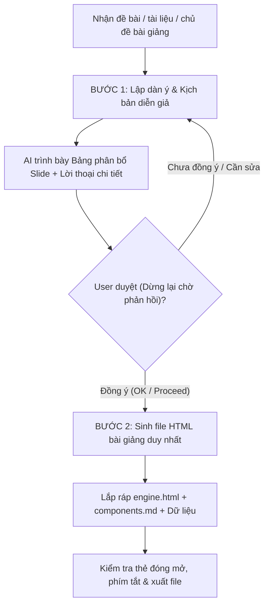

# KỸ NĂNG: TẠO SLIDE BÀI GIẢNG TRÌNH CHIẾU TƯƠNG TÁC CAO CẤP (Q-TAO-SLIDE-BAI-GIANG)

Tài liệu này định nghĩa quy trình chuẩn mực dành cho AI khi được yêu cầu tạo bài giảng, slide trình chiếu chuyên nghiệp từ bất kỳ đề tài, tài liệu hay bài học nào.

---

## 1. TRIẾT LÝ CỐT LÕI (DESIGN PHILOSOPHY)

Mọi bài giảng được tạo ra bởi skill này BẮT BUỘC phải tuân thủ 5 nguyên tắc:
1. **Độc Lập 100% (Single-file Zero-dependency):** Toàn bộ bài giảng gói gọn trong **1 file `.html` duy nhất**. Chạy ngay lập tức trên mọi trình duyệt (Chrome, Edge, Safari, Firefox) mà không cần cài đặt `npm`, `node_modules` hay build tool.
2. **Thẩm Mỹ Hiện Đại (Glassmorphism & High-contrast Dark UI):** Nền tối sâu thẳm, card kính mờ viền tinh tế, phông chữ `JetBrains Mono` kết hợp `Plus Jakarta Sans`, độ tương phản cao, chống mỏi mắt.
3. **Chuyển Động Vi Mô Cuốn Hút (Micro-animations):** Từng phần tử con trong slide tự động lướt lên so le (Staggered fade-up) khi chuyển trang, viền phát sáng (Glow border hover) khi rê chuột.
4. **Ngăn Kéo Lời Thoại Diễn Giả (Speaker Notes Drawer):** Tích hợp kịch bản người nói chi tiết vào thuộc tính `data-notes` của từng slide. Diễn giả chỉ cần nhấn phím **`S`** để mở ngăn kéo xem lời thoại tự nhiên khi thuyết trình.
5. **Sẵn Sàng Xuất Bản In (Print to PDF Ready):** Thiết lập sẵn `@media print` chuẩn A4 landscape, chỉ cần nhấn **`Ctrl + P`** là có ngay tài liệu handout phát cho học viên.

---

## 2. QUY TRÌNH VẬN HÀNH 2 BƯỚC (2-PHASE PROTOCOL)

Khi người dùng yêu cầu tạo bài giảng mới, AI BẮT BUỘC tuân thủ quy trình 2 bước:

---

### BƯỚC 1: LẬP DÀN Ý & KỊCH BẢN LỜI THOẠI (OUTLINE & SPEAKER SCRIPT)

1. **Phân tích đề bài:**
   - Xác định rõ: Tên bài giảng, thời lượng dự kiến (ví dụ: 45 phút ~ 10-15 slides; 90-120 phút ~ 20-30 slides), đối tượng học viên (Fresher, Middle, Sinh viên, Quản lý, Non-tech).
   - Lựa chọn Theme màu sắc:
     - `theme-cyber-dark` (Mặc định): Dành cho Kỹ thuật, Lập trình, AI, DevOps, Dữ liệu.
     - `theme-deep-navy`: Dành cho Quản trị, Agile, Kinh doanh, Quản lý sản phẩm.
     - `theme-clean-light`: Dành cho Hội thảo giáo dục, Kỹ năng mềm, Bài giảng ban ngày.

2. **Lập Bảng Cấu Trúc Slide Chi Tiết:**
   Trình bày ra cho người dùng theo bảng sau:

   | STT | Eyebrow Tag | Tiêu Đề Slide | Component Layout | Tóm Tắt Nội Dung Trình Chiếu | Kịch Bản Lời Thoại Diễn Giả (`data-notes`) |
   |:---:|:---|:---|:---|:---|:---|
   | 01 | ⚡ MỞ ĐẦU | [Tên bài giảng lớn] | Cover Slide | Vấn đề nhức nhối vs Mục tiêu đạt được | "Chào các bạn, hôm nay chúng ta sẽ giải quyết..." |
   | 02 | ⚖️ SO SÁNH | [Chủ đề đối chiếu] | Split 2 Cột | Sai lầm phổ biến vs Chuẩn chuyên nghiệp | "Hầu hết mọi người thường mắc sai lầm là..." |
   | ... | ... | ... | ... | ... | ... |

3. **CỔNG CHỜ PHÊ DUYỆT (HARD GATE):**
   - **Dừng lại ngay sau khi xuất bản dàn ý.**
   - Hỏi người dùng xem có cần bổ sung hoặc điều chỉnh slide nào trước khi sinh mã nguồn hay không.

---

### BƯỚC 2: XUẤT BẢN FILE HTML HOÀN CHỈNH (SINGLE-FILE GENERATION)

Sau khi người dùng đồng ý (gõ "OK", "đồng ý", "tiếp tục"):
1. Đọc bộ khung gốc từ `templates/engine.html`.
2. Thay thế các biến placeholder:
   - `{{PRESENTATION_TITLE}}`: Tiêu đề hiển thị trên tab trình duyệt.
   - `{{THEME_CLASS}}`: Class chủ đề màu (`theme-cyber-dark`, `theme-deep-navy`, hoặc `theme-clean-light`).
   - `{{TOPIC_TAG}}`: Nhãn chuyên đề trên header (ví dụ: `DEVELOPER MASTERCLASS`, `AGILE LEADERSHIP`).
   - `{{SERIES_TITLE}}`: Tên chuỗi bài giảng hoặc khóa học.
   - `{{TOTAL_SLIDES}}`: Tổng số slide (định dạng 2 chữ số, ví dụ `24`).
   - `{{COPYRIGHT_TEXT}}`: Bản quyền & năm đào tạo (ví dụ: `Bản quyền Đào Tạo Nội Bộ • 2026`).
3. Lắp ráp các slide vào vị trí `{{SLIDES_CONTENT}}`:
   - Sử dụng các mẫu HTML từ `references/components.md`.
   - Mỗi slide phải có `data-slide="X"` và `data-notes="..."`.
   - Slide số 1 luôn có `class="slide active"`, các slide còn lại là `class="slide"`.
4. Ghi file trực tiếp ra đường dẫn người dùng yêu cầu hoặc thư mục hiện tại: `slide_<ten_bai_viet_tat>.html`.

---

## 3. TIÊU CHUẨN VIẾT KỊCH BẢN LỜI THOẠI DIỄN GIẢ (`data-notes`)

Một bài giảng hay nằm ở 80% phần giảng giải của diễn giả, slide chỉ đóng vai trò điểm tựa thị giác. Khi soạn `data-notes`:
- **KHÔNG** sao chép lại từng chữ trên slide hay viết gạch đầu dòng khô khan.
- **BẮT BUỘC** viết thành văn phong nói tự nhiên, mượt mà, xưng hô gần gũi ("anh / tôi / mình").
- **Cấu trúc 4 phần của một lời thoại chuẩn:**
  1. *Đặt vấn đề (Hook):* Nêu câu hỏi hoặc một tình huống bế tắc mà học viên thường gặp trong thực tế.
  2. *Giải thích bản chất (Why):* Phân tích tại sao cách làm cũ lại sai, gốc rễ của vấn đề là gì.
  3. *Hành động thực chiến (How):* Chỉ rõ từng bước giải quyết, chia sẻ kinh nghiệm xử lý ngoài đời thật.
  4. *Thông điệp cốt lõi (Takeaway):* Một câu chốt ngắn gọn, đắt giá để học viên ghi nhớ.

---

## 4. KHO THÀNH PHẦN GIAO DIỆN (UI COMPONENTS)

Tra cứu file `references/components.md` để lấy mã nguồn mẫu cho:
1. **Cover / Hero Slide:** Mở màn ấn tượng với gradient title và 2 cột Thực trạng vs Mục tiêu.
2. **Split Comparison (2 Cột):** Đối chiếu trực diện Sai vs Đúng, Cũ vs Mới.
3. **Grid-3 (3 Cột):** Chu trình 3 bước hoặc 3 trụ cột kỹ năng.
4. **Grid-4 (4 Cột):** 4 nguyên tắc cốt lõi hoặc 4 module kiến trúc.
5. **Terminal / Code Mockup:** Cửa sổ dòng lệnh chuẩn macOS/Linux có dot buttons và syntax highlight.
6. **Comparison Table:** Bảng ma trận so sánh nhiều phương án kèm Badge pills.
7. **Lifecycle / Pipeline Flow:** Chuỗi trạng thái công việc từ To Do ➔ Done với mũi tên kết nối.
8. **KPI Stats:** Thống kê số liệu đột phá kích thước lớn (-65%, 99.9%, 3.5x).
9. **Summary & Q&A Slide:** Đúc kết hành trang thực chiến và mở rộng thảo luận.

---

## 5. CHECKLIST KIỂM THỬ TRƯỚC KHI BÀN GIAO

Trước khi hoàn tất nhiệm vụ, AI phải tự rà soát:
- [ ] File là một file HTML độc lập duy nhất (Single-file), mở trực tiếp bằng trình duyệt được ngay.
- [ ] Slide đầu tiên có class `active`, tất cả các slide sau không có.
- [ ] Thuộc tính `data-notes` trên từng slide đã được điền đầy đủ lời thoại tự nhiên (không để rỗng).
- [ ] Bộ đếm slide trên header (`slideNumDisplay`) hiển thị đúng tổng số slide.
- [ ] Tất cả các thẻ HTML, thẻ `
`, ``, `
` được đóng mở cân bằng tuyệt đối.
- [ ] Phím tắt hoạt động mượt mà: Mũi tên trái/phải/Space, phím S (Notes), phím F (Fullscreen).
