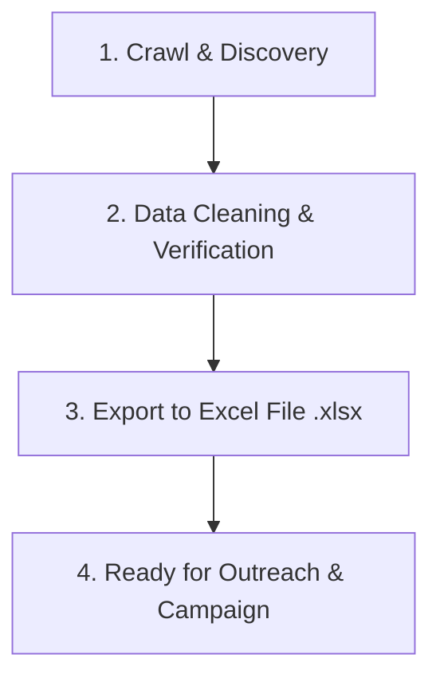

# 📊 Quy Trình Crawler & Xuất Dữ Liệu Excel Liên Hệ Đoàn - Hội / CLB Sinh Viên

Tài liệu này định nghĩa tiêu chuẩn và quy trình cho việc thu thập dữ liệu liên hệ công khai từ các trường Đại học, Đoàn Thanh niên, Hội Sinh viên và các Câu lạc bộ (CLB) sinh viên trên toàn quốc, làm sạch dữ liệu và **xuất ra file Excel (.xlsx)** để phục vụ công tác tiếp cận, không can thiệp vào cơ sở dữ liệu hay mã nguồn dự án.

---

## 🎯 MỤC TIÊU & PHẠM VI

1. **Thu thập dữ liệu chính xác 100%:** Thu thập các thông tin liên hệ công khai (Email đại diện, Fanpage URL, Hotline công khai, Zalo liên hệ) của các tổ chức sinh viên.
2. **Đầu ra duy nhất (Output):** Xuất ra file **Excel (`.xlsx`)** được định dạng chuyên nghiệp (chia tab theo Khu vực/Loại hình CLB), sẵn sàng cho việc gửi mail hoặc liên hệ.
3. **Không sửa đổi codebase/Database:** Hoạt động độc lập thông qua script/tool tự động, không yêu cầu tạo bảng DB hay thay đổi mã nguồn dự án `halo_web`.
4. **Tuân thủ pháp lý:** Tuân thủ **Nghị định 13/2023/NĐ-CP** về Bảo vệ dữ liệu cá nhân (Chỉ thu thập thông tin đại diện tổ chức/CLB công khai).

---

## 🔄 QUY TRÌNH 4 BƯỚC THỰC HIỆN (EXCEL-DRIVEN PIPELINE)



---

### Bước 1: Crawl & Discovery (Thu Thuập Dữ Liệu Công Khai)

- **Nguồn dữ liệu:**
  - Website chính thức các trường Đại học/Cao đẳng (`.edu.vn`).
  - Fanpage Facebook chính thức của Đoàn Thanh niên / Hội Sinh viên trường.
  - Fanpage các Câu lạc bộ (Học thuật, Kỹ năng, Truyền thông, Thể thao, Nghệ thuật).
  - Tệp PDF thông báo / Form đăng ký công khai của CLB.
- **Trường thông tin cần thu thập:**
  1. `STT`: Số thứ tự.
  2. `Ten_Truong`: Tên trường Đại học / Cao đẳng (Ví dụ: Đại học Bách Khoa Hà Nội).
  3. `Ma_Truong`: Mã trường (Ví dụ: BKA).
  4. `Khu_Vuc`: Miền Bắc / Miền Trung / Miền Nam.
  5. `Ten_To_Chuc_CLB`: Tên Đoàn - Hội hoặc CLB (Ví dụ: CLB Lập trình BKHN).
  6. `Loai_Hinh`: Đoàn Thanh niên / Hội Sinh viên / Học thuật / Truyền thông / Kỹ năng / Thể thao.
  7. `Email_Cong_Khai`: Email đại diện liên hệ.
  8. `Fanpage_URL`: Đường link Fanpage Facebook.
  9. `Hotline_Zalo`: SĐT hoặc link Zalo liên hệ công khai.
  10. `Trang_Thai_Email`: Valid / Suspicious / Invalid (sau khi verify).

---

### Bước 2: Data Cleaning & Verification (Làm Sạch & Xác Thực Dữ Liệu)

1. **Chuẩn hóa Email & SĐT:**
   - Đưa Email về chữ thường (`lowercase`), xóa khoảng trắng thừa.
   - Format SĐT về dạng chuẩn `0xxxxxxxxx`.
2. **Loại bỏ trùng lặp (Deduplication):**
   - Loại bỏ các dòng trùng lặp Email hoặc trùng lặp Link Fanpage.
3. **Xác thực Mailbox (Email Verification):**
   - Lọc bỏ các email hệ thống (`noreply@`, `no-reply@`).
   - Kiểm tra định dạng Regex Email và kiểm tra domain MX Record.

---

### Bước 3: Export To Excel File (`.xlsx`)

Xuất kết quả ra file Excel chuẩn với cấu trúc sau:

- **Tên file:** `Danh_Sach_Lien_He_Doan_Hoi_CLB_<Ngay_Xuat>.xlsx`
- **Cấu trúc các Sheets (Tabs):**
  - **Sheet 1 (`Toan_Quoc`):** Tổng hợp toàn bộ dữ liệu đã verify.
  - **Sheet 2 (`Mien_Bac`):** Các trường & CLB khu vực Miền Bắc.
  - **Sheet 3 (`Mien_Trung`):** Các trường & CLB khu vực Miền Trung.
  - **Sheet 4 (`Mien_Nam`):** Các trường & CLB khu vực Miền Nam.
- **Định dạng bảng Excel:**
  - Header tô màu tím/xanh đậm, chữ trắng, in đậm.
  - Bật chế độ Auto-Filter cho các cột.
  - Căn chỉnh độ rộng cột tự động phù hợp với nội dung.

---

### Bước 4: Hướng Dẫn Sử Dụng File Excel Để Outreach

Sau khi có file Excel, bạn có thể:
1. **Import vào Gmail / Outlook:** Gửi mail hàng loạt qua tính năng Mail Merge (Hợp nhất thư) của Microsoft Word/Outlook hoặc qua Google Sheets Extension (YAMM / Mail Meteor).
2. **Gửi Mail Automation bằng Python / Script:** Đọc file Excel và tự động gửi thư ngỏ qua SMTP/Gmail API kèm rate limit (50-100 mail/ngày).
3. **Chuyển cho Đội ngũ Marketing / BD:** Gọi điện hoặc nhắn tin Zalo theo danh sách SĐT/Hotline đã lọc.

---

## ✉️ MẪU THƯ NGỎ ĐỒNG HÀNH CHUẨN (DÙNG CHO MAIL MERGE EXCEL)

```text
Tiêu đề: [Đồng hành Truyền thông & Tài trợ] {{Ten_San_Pham}} gửi tặng giải pháp cho {{Ten_To_Chuc_CLB}} - {{Ten_Truong}}

Kính gửi Ban Quản trị / Ban Đối ngoại {{Ten_To_Chuc_CLB}},

Lời đầu tiên, {{Ten_San_Pham}} xin gửi lời chào trân trọng nhất tới Ban Quản trị cùng toàn thể thành viên {{Ten_To_Chuc_CLB}} - {{Ten_Truong}}.

Chúng tôi được biết {{Ten_To_Chuc_CLB}} là một trong những tổ chức/câu lạc bộ rất năng động và có nhiều hoạt động ý nghĩa dành cho sinh viên {{Ten_Truong}}.

Nhằm đồng hành và hỗ trợ các bạn sinh viên trong học tập cũng như hoạt động phong trào, {{Ten_San_Pham}} trân trọng gửi tới {{Ten_To_Chuc_CLB}} chương trình hợp tác đồng hành:

🎁 Quyền lợi dành riêng cho {{Ten_To_Chuc_CLB}}:
1. Cấp tài khoản trải nghiệm Premium miễn phí cho 100% thành viên CLB.
2. Tài trợ học bổng / quà tặng cho các sự kiện, cuộc thi do {{Ten_To_Chuc_CLB}} tổ chức.
3. Hỗ trợ truyền thông bài đăng sự kiện của CLB trên các kênh chính thức của {{Ten_San_Pham}}.

Rất mong có cơ hội được trao đổi ngắn 10 phút qua Zalo/Online với Đại diện Ban Đối ngoại của {{Ten_To_Chuc_CLB}} để thảo luận chi tiết hơn về hình thức đồng hành.

- Link giới thiệu sản phẩm: {{Link_Product}}
- Hotline / Zalo liên hệ Đối ngoại: {{Hotline_Doi_Ngoai}}

Trân trọng,
---
[Đại diện Ban Đối ngoại {{Ten_San_Pham}}]
Website: {{Website_Company}}
```
