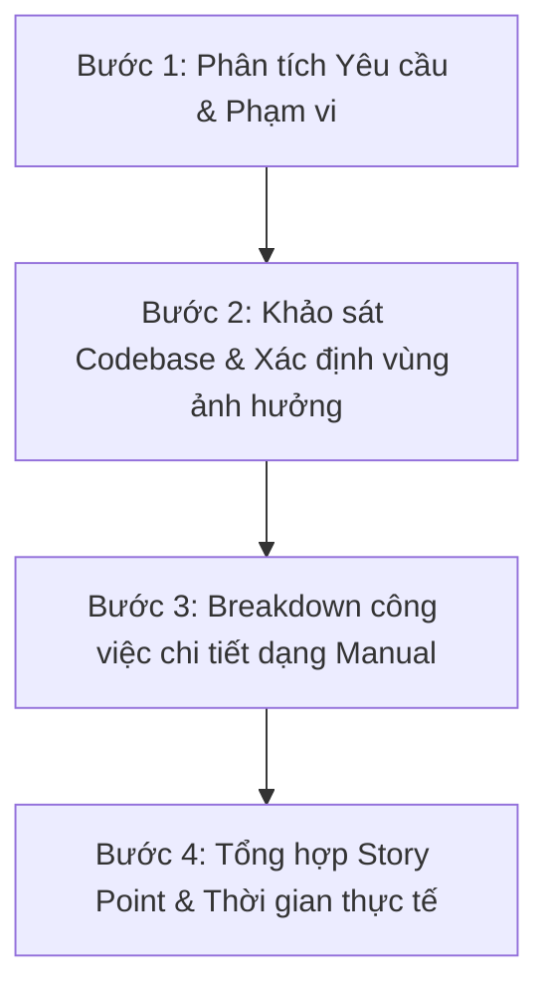

# Ước Lượng Story Point & Thời Gian Xử Lý Ticket Của Senior Engineer (Không Dùng AI)

Kỹ năng này giúp AI phân tích một yêu cầu (ticket, issue, spec) và đưa ra dự báo chính xác về thời gian mà một **Senior Engineer thực tế (không có sự trợ giúp của AI)** cần để hoàn thành công việc từ lúc bắt đầu cho đến khi PR được merge và sẵn sàng deploy.

---

## 1. Nguyên Tắc Cốt Lõi Khi Ước Lượng Không Dùng AI

Một Senior Engineer không dùng AI (không dùng Copilot, ChatGPT, v.v.) phải tự mình thực hiện mọi khâu một cách thủ công và tư duy độc lập:
*   **Đọc và hiểu codebase**: Phải tự điều hướng mã nguồn, đọc hiểu các luồng dữ liệu phức tạp mà không có tính năng giải thích mã của AI.
*   **Tự viết mã nguồn (Coding)**: Gõ từng dòng code, tự nhớ cú pháp, tự thiết kế cấu trúc lớp (class), hàm (function) tuân thủ SOLID và Clean Code.
*   **Tự tìm kiếm tài liệu (Manual Research)**: Tra cứu API, thư viện, hoặc StackOverflow thủ công khi gặp lỗi hoặc thư viện mới.
*   **Debug & Sửa lỗi (Debugging)**: Phân tích log, đặt debug breakpoint, lần theo stack trace để tìm nguyên nhân gốc rễ.
*   **Viết Tests (Testing)**: Thiết kế và viết Unit Test (RSpec, Jest, v.v.) và Integration Test thủ công để bao phủ toàn bộ các case (happy path, edge case, failure path).
*   **Kiểm thử thủ công (Manual Verification)**: Tự cài đặt dữ liệu test, khởi động môi trường local, thao tác trên giao diện hoặc gọi API qua Postman/Curl để kiểm chứng.
*   **Quy trình Phụ trợ (Overhead)**: Giải quyết các conflict khi merge code, tối ưu hóa code sau review, chờ CI/CD build chạy kiểm tra, tương tác với Tester/QA và các buổi họp làm rõ yêu cầu (refinement).

---

## 2. Ma Trận Đánh Giá Độ Phức Tạp (Complexity Matrix)

Để ước lượng chính xác, Senior Engineer cần đánh giá ticket qua các chiều kích sau:

### A. Độ Quen Thuộc (Familiarity)
*   **Cao (High)**: Đã từng làm việc trên module này nhiều lần. Thuộc lòng luồng xử lý và cấu trúc dữ liệu.
*   **Trung bình (Medium)**: Hiểu kiến trúc chung của dự án nhưng ít khi đụng vào module cụ thể này. Cần khoảng 1-2 giờ đọc code để bắt nhịp.
*   **Thấp (Low)**: Module mới hoàn toàn hoặc legacy code do người khác viết không có tài liệu. Cần 3-6 giờ (hoặc hơn) chỉ để khảo sát luồng và hiểu cách thức hoạt động.

### B. Độ Phức Tạp Logic Nghiệp Vụ (Business Logic Complexity)
*   **Thấp (Low)**: Sửa text, cập nhật giao diện tĩnh, thêm một trường dữ liệu đơn giản không có ràng buộc phức tạp.
*   **Trung bình (Medium)**: Thay đổi luồng nghiệp vụ hiện tại, tính toán có điều kiện, xử lý bất đồng bộ cơ bản, tích hợp API nội bộ.
*   **Cao (High)**: Logic nghiệp vụ phức tạp, nhiều điều kiện rẽ nhánh, tích hợp cổng thanh toán bên thứ ba, xử lý giao dịch tài chính đòi hỏi tính nhất quán dữ liệu (ACID), xử lý hàng đợi (queue) với tải lượng lớn.

### C. Phạm Vi Ảnh Hưởng & Tác Dụng Phụ (Blast Radius & Side Effects)
*   **Cục bộ (Isolated)**: Thay đổi chỉ tác động trong phạm vi file hoặc module độc lập, không có dependency nào khác gọi tới.
*   **Vừa phải (Moderate)**: Thay đổi ảnh hưởng tới một vài API hoặc component liên quan trực tiếp. Cần kiểm thử hồi quy (regression testing) nhẹ.
*   **Toàn cục (Global/Core)**: Sửa đổi cấu trúc DB lõi, middleware, cơ chế authentication, hoặc các hàm tiện ích dùng chung toàn hệ thống. Rủi ro cao, cần kiểm thử diện rộng.

### D. Yêu Cầu Về Testing
*   **Đơn giản**: Chỉ cần viết unit test cơ bản cho class/method mới.
*   **Trung bình**: Cần viết unit test và integration test bao phủ luồng API hoặc giao diện người dùng.
*   **Phức tạp**: Cần mocking/stubbing các dịch vụ bên ngoài, giả lập môi trường mạng lỗi, test hiệu năng hoặc bảo mật.

---

## 3. Bảng Quy Đổi Story Points (SP) Sang Thời Gian Thực Tế

> [!NOTE]
> Bảng quy đổi dưới đây dựa trên thời gian làm việc thực tế (Ideal Hours/Days) của một **Senior Engineer làm việc tập trung, không bị gián đoạn và KHÔNG dùng AI**.

| Story Points | Thời gian ước lượng (Giờ công / Ngày) | Loại công việc điển hình | Mô tả chi tiết quy trình thực hiện thủ công |
| :---: | :---: | :--- | :--- |
| **1 SP** | **2 - 4 giờ** | Thay đổi nhỏ, rõ ràng. | - Khảo sát code: 30 phút.<br>- Coding: 1 giờ.<br>- Viết Unit Test: 30 phút.<br>- Manual verify & Tạo PR: 30 phút - 1 giờ. |
| **2 SP** | **4 - 8 giờ** (0.5 - 1 ngày) | Bug fix thông thường hoặc tính năng nhỏ trên module đã quen thuộc. | - Tái hiện bug & phân tích: 1-2 giờ.<br>- Coding: 2-3 giờ.<br>- Viết unit test bổ sung: 1-2 giờ.<br>- Verify & xử lý PR feedback: 1-2 giờ. |
| **3 SP** | **12 - 20 giờ** (1.5 - 2.5 ngày) | Tính năng mới tầm trung hoặc refactor nhẹ một module. | - Khảo sát codebase & thiết kế giải pháp: 3-4 giờ.<br>- Coding: 6-8 giờ.<br>- Viết Unit & Integration Test đầy đủ: 3-4 giờ.<br>- Manual testing trên nhiều kịch bản: 2 giờ.<br>- Tạo PR, giải quyết conflict, review sửa đổi: 2-3 giờ. |
| **5 SP** | **24 - 40 giờ** (3 - 5 ngày) | Tính năng phức tạp, thay đổi database schema, tích hợp API mới. | - Phân tích yêu cầu, họp làm rõ (nếu có): 4 giờ.<br>- Thiết kế DB, kiến trúc & Technical Design: 4-6 giờ.<br>- Coding & Refactor legacy code: 12-16 giờ.<br>- Viết test suites (Unit, Integration, Edge cases): 6-8 giờ.<br>- Chạy manual test, verify dữ liệu DB: 3-4 giờ.<br>- Code Review, sửa đổi theo feedback: 4 giờ. |
| **8 SP** | **48 - 80 giờ** (6 - 10 ngày) | Epic lớn hoặc tính năng cốt lõi phức tạp cao, tích hợp hệ thống ngoài. | - Nghiên cứu tài liệu API bên thứ 3, viết Proof of Concept (PoC): 1.5 - 2 ngày.<br>- Thiết kế hệ thống, DB, bảo mật: 1 ngày.<br>- Coding phân đoạn: 3-4 ngày.<br>- Viết test suite toàn diện & mocking: 1.5 ngày.<br>- Hỗ trợ QA/Tester lên kịch bản test: 0.5 ngày.<br>- Deploy staging & sửa lỗi phát sinh: 1 ngày. |
| **13 SP** | **> 80 giờ** (> 2 tuần) | Dự án hoặc hệ thống lớn. | **Khuyến nghị**: Ticket quá lớn, tiềm ẩn nhiều rủi ro. Cần phải phân rã (breakdown) thành các ticket nhỏ hơn (tối đa 5 SP hoặc 8 SP). |

---

## 4. Quy Trình 4 Bước Phân Tích & Ước Lượng Chuyên Sâu

Khi thực hiện kỹ năng này, AI cần chạy qua 4 bước tư duy sau:



### Bước 1: Phân tích Yêu cầu & Phạm vi
*   Đọc kỹ mô tả ticket để xác định:
    *   Mục tiêu nghiệp vụ là gì?
    *   Các kịch bản sử dụng (User Stories) là gì?
    *   Có điểm nào chưa rõ ràng, thiếu thông tin cần BA/PO làm rõ không?

### Bước 2: Khảo sát Codebase & Xác định vùng ảnh hưởng (Impact Analysis)
*   Sử dụng công cụ tìm kiếm trong dự án để xác định:
    *   Những file nào cần sửa đổi? Những file nào cần tạo mới?
    *   Có ảnh hưởng đến database schema hiện tại không (migration)?
    *   Những hàm/module nào phụ thuộc vào code sắp sửa đổi (side effects)?

### Bước 3: Breakdown công việc chi tiết dạng Manual
*   Chia nhỏ công việc thành các bước thực thi cụ thể không dùng AI:
    1.  *Khảo sát & Thiết kế giải pháp* (Nghiên cứu cấu trúc code hiện tại, lên sơ đồ lớp/luồng dữ liệu).
    2.  *Coding* (Viết mã nguồn chính cho các file).
    3.  *Database Migration* (nếu có).
    4.  *Testing* (Viết Unit Test, Integration Test).
    5.  *Manual Verification* (Các bước tự kiểm thử local để chắc chắn code chạy đúng).
    6.  *Code Review & CI/CD* (Thời gian giải quyết feedback, xử lý CI failure).

### Bước 4: Tổng hợp Story Point & Thời gian thực tế
*   Áp dụng Ma Trận Độ Phức Tạp để tính toán Story Point phù hợp.
*   Đưa ra khoảng thời gian hoàn thành cụ thể (ví dụ: 12 - 16 giờ làm việc) dựa trên bảng quy đổi ở mục 3.
*   Đưa ra các giả định (Assumptions) và rủi ro (Risks) có thể kéo dài thời gian xử lý.

---

## 5. Mẫu Báo Cáo Phân Tích & Ước Lượng (Output Template)

Khi áp dụng kỹ năng này để trả lời hoặc phân tích một ticket, AI cần phản hồi theo cấu trúc chuẩn sau:

```markdown
### 📊 BÁO CÁO PHÂN TÍCH & ƯỚC LƯỢNG TICKET (SENIOR NO-AI)

**Ticket:** [Tên Ticket / Link Ticket]

#### 1. Phân tích Yêu cầu & Phạm vi (Scope Analysis)
*   **Mục tiêu chính:** [Tóm tắt ngắn gọn mục tiêu kỹ thuật & nghiệp vụ]
*   **Luồng xử lý chính:**
    1. [Bước 1]
    2. [Bước 2]

#### 2. Vùng Ảnh Hưởng & File Thay Đổi (Impacted Files)
*   **File sửa đổi (Modify):**
    *   `path/to/file_a.rb` (Lý do: ...)
    *   `path/to/file_b.js` (Lý do: ...)
*   **File tạo mới (New):**
    *   `path/to/new_service.rb` (Lý do: ...)
*   **Database Changes:** [Có/Không - Chi tiết schema thay đổi nếu có]

#### 3. Breakdown Công Việc Chi Tiết & Ước Lượng Thời Gian (Manual Task Breakdown)
*   **P1. Nghiên cứu & Thiết kế giải pháp:** `X giờ` (Tìm hiểu logic module A, lên phương án sửa đổi không side-effect)
*   **P2. Coding chính:** `Y giờ` (Viết code logic, định nghĩa API, xử lý DB migration)
*   **P3. Viết Automated Tests:** `Z giờ` (Viết Unit test cho class mới, viết integration test cho luồng API)
*   **P4. Kiểm thử thủ công (Manual Testing):** `W giờ` (Seed dữ liệu, test các kịch bản happy path và edge cases)
*   **P5. Quy trình PR & Code Review:** `V giờ` (Tạo PR, chờ CI build, fix conflict, phản hồi và sửa đổi theo code review)

#### 4. Rủi ro & Giả định (Risks & Assumptions)
*   *Rủi ro 1:* [Ví dụ: Code cũ ở module A quá rối rắm, thiếu unit test bảo vệ nên việc refactor thủ công rất dễ lỗi]
*   *Giả định:* [Ví dụ: API bên thứ 3 hoạt động ổn định và tài liệu của họ chính xác]

#### 5. Kết luận Story Points & Thời Gian Hoàn Thành
*   **Độ phức tạp đánh giá:** [Thấp / Trung bình / Cao]
*   **Đề xuất Story Points:** **[X] SP**
*   **Tổng thời gian dự kiến (Không AI):** **[Y] - [Z] giờ làm việc thực tế** (Tương đương **[N] ngày công**)
```
