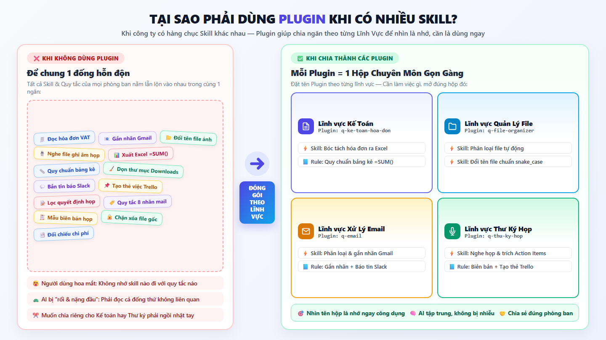
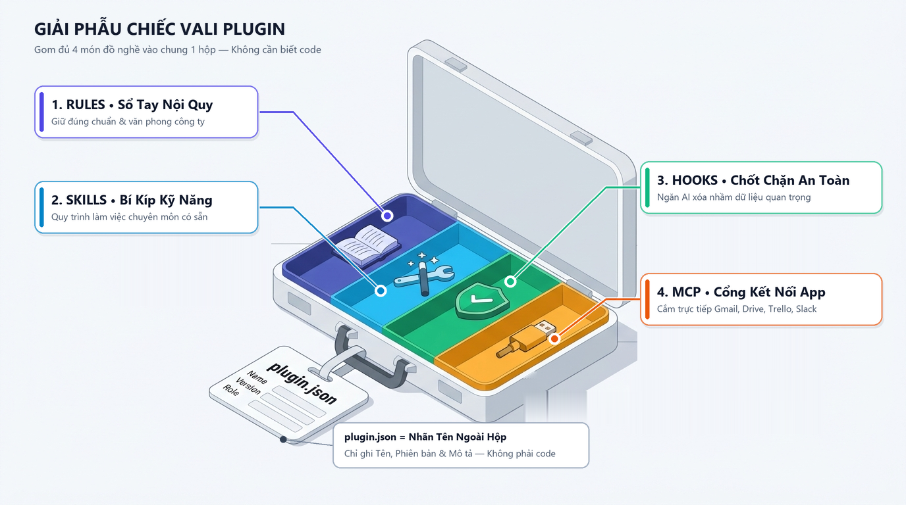
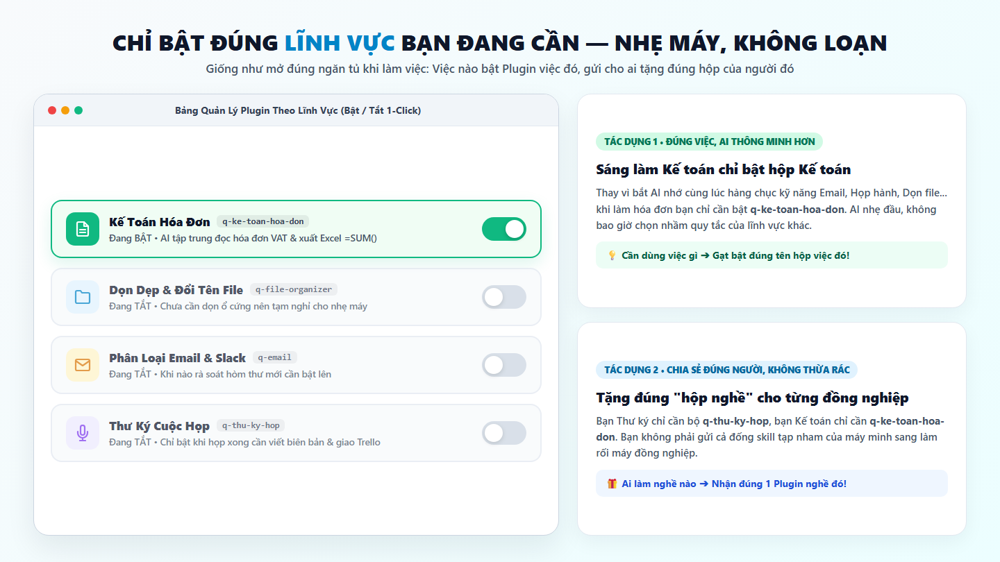

# KỊCH BẢN LỜI THOẠI BÀI HỌC 8.1
**Khóa học:** Làm Chủ Google Antigravity Cho Người Không Chuyên  
**Khối 2:** Kho Vũ Khí 7 Trụ Cột Cho Dân Văn Phòng  
**Phần 8:** Trụ Cột 6 & 7 — Plugins & Automations: Vali Nghề & Trợ Lý Hẹn Giờ  
**Tên bài:** Bài 8.1: Plugins — Chia Hộp Đồ Nghề Theo Từng Lĩnh Vực (Hết Loạn Skill, Dễ Nhớ & Dễ Dùng)  
**Thời lượng dự kiến:** 08:00  
**Slide tương ứng:** `phan_08_tru_cot_plugins_automations.html` (Slide 1)

---

## 🎬 1. CHUẨN BỊ TRƯỚC KHI QUAY
* **Cửa sổ trình chiếu:** Mở tệp slide `slides/phan_08_tru_cot_plugins_automations.html` (Slide 1: Trụ Cột 6 — Plugins: Chiếc Vali Vũ Khí Số).
* **Bộ 3 hình minh họa trực quan đi kèm** (hiển thị luân phiên trên màn hình/OBS khi giảng):
  1. `../images/plugin_01_loan_skill_vs_chia_hop.png` — Khi có quá nhiều Skill thuộc các lĩnh vực khác nhau: Đống hỗn độn vs. Chia thành các hộp Plugin theo tên lĩnh vực.
  2. `../images/plugin_02_giai_phau_vali.png` — Mở nắp một chiếc hộp Plugin: Nhãn tên `plugin.json` và các ngăn bên trong.
  3. `../images/plugin_03_bat_tat_linh_vuc.png` — Bật đúng hộp lĩnh vực đang làm, chia sẻ đúng hộp nghề cho từng đồng nghiệp.
* **Minh họa thư mục thực tế:** Mở thư mục `Demo\.agents\plugins\` để học viên nhìn thấy tận mắt 4 chiếc hộp Plugin chia theo 4 lĩnh vực riêng biệt: `q-ke-toan-hoa-don`, `q-file-organizer`, `q-email`, `q-thu-ky-hop`.
* **Tông giọng:** Gần gũi, thực tế, nói đúng nỗi đau của người đi làm văn phòng khi phải quản lý quá nhiều công cụ AI.

---

## 🎙️ 2. KỊCH BẢN LỜI THOẠI CHI TIẾT (WORD-FOR-WORD SCRIPT)

### [00:00 - 02:30] MỞ ĐẦU: NỖI KHỔ KHI CÓ QUÁ NHIỀU SKILL KHÁC NHAU — ĐỂ CHUNG LÀ LOẠN!
`[Hiển thị Slide 1: Trụ Cột 6 — Plugins: Chiếc Vali Vũ Khí Số]`  
`[Chiếu Hình minh họa 1: Tại sao phải dùng Plugin khi có nhiều Skill?]`



"Chào mừng các bạn đến với **Phần 8: Trụ Cột 6 & 7 — Plugins & Automations**!

Nhiều bạn khi mới nghe về Plugin hay thắc mắc:  
*'Ủa, nếu muốn chép sang máy khác thì mình chỉ việc copy cả thư mục Rules và Skills ném sang máy đồng nghiệp là xong, cần gì phải đóng gói thành Plugin cho rắc rối?'*

Câu hỏi rất hay! Nếu bạn chỉ có 1–2 kỹ năng nhỏ thì đúng là không cần Plugin.  
**Nhưng hãy giả định điều chắc chắn sẽ xảy ra sau 1 tháng bạn dùng AI cho công việc:**  
Lúc này bạn tích lũy được hàng chục kỹ năng (`Skills`) và quy tắc (`Rules`) ở đủ mọi lĩnh vực khác nhau:
* Mảng **Kế toán:** có skill đọc hóa đơn VAT, skill xuất Excel `=SUM()`, quy chuẩn lập bảng kê.
* Mảng **Dọn dẹp File:** có skill phân loại thư mục Downloads, skill đổi tên file ảnh/PDF.
* Mảng **Email:** có skill đọc & gắn 8 nhãn Gmail, quy chuẩn gửi tin báo sang Slack.
* Mảng **Thư ký họp:** có skill nghe file ghi âm, lọc quyết định họp, tạo thẻ việc Trello.

**Hãy nhìn sang bên trái bức hình này (`KHI KHÔNG DÙNG PLUGIN`):**  
Nếu bạn để tất cả 15–20 thứ đó nằm chung vào một chỗ:
1. **Chính bạn nhìn vào cũng bị hoa mắt:** Tên skill và quy tắc nằm lẫn lộn, bạn không nhớ nổi cái nào đi với cái nào, mỗi lần tìm rất mất công.
2. **Con AI cũng bị 'rối và nặng đầu':** Sáng nay bạn chỉ muốn đối chiếu hóa đơn, nhưng AI lại phải gánh theo cả đống hướng dẫn về họp hành, email, dọn file... khiến nó xử lý chậm hơn và dễ áp nhầm quy tắc.
3. **Khó tách riêng cho từng người:** Bạn muốn gửi riêng bộ công cụ Họp hành cho bạn Thư ký mà không dính đồ nghề Kế toán, bạn lại phải ngồi nhặt tay từng file một trong đống hỗn độn đó!

**Bây giờ hãy nhìn sang bên phải bức hình (`KHI CHIA THÀNH CÁC PLUGIN`):**  
Tác dụng lớn nhất của **Plugin** chính là **chia nhỏ đống đồ nghề hỗn độn đó thành từng chiếc Hộp Chuyên Môn mang tên từng lĩnh vực**:
* Hộp **`q-ke-toan-hoa-don`**: Chỉ chứa kỹ năng và quy chuẩn của **Kế toán**.
* Hộp **`q-file-organizer`**: Chỉ chứa kỹ năng **Quản lý & dọn dẹp File**.
* Hộp **`q-email`**: Chỉ chứa kỹ năng và quy tắc **Xử lý Email**.
* Hộp **`q-thu-ky-hop`**: Chỉ chứa kỹ năng và mẫu biểu của **Thư ký cuộc họp**.

Chỉ cần nhìn vào **tên của từng Plugin**, bạn biết ngay hộp nào dùng cho việc gì — cực kỳ dễ nhớ, dễ tìm và không bao giờ bị loạn!"

---

### [02:30 - 05:00] MỞ NẮP MỘT CHIẾC HỘP PLUGIN: BÊN TRONG CÓ GÌ?
`[Chiếu Hình minh họa 2: Giải phẫu chiếc Vali Plugin]`  
`[Mở thư mục Demo\.agents\plugins\ trên màn hình để học viên thấy 4 thư mục con tương ứng 4 lĩnh vực]`



"Bây giờ, tôi sẽ mở thử nắp một chiếc hộp Plugin thực tế trên máy tính của tôi — ví dụ hộp **`q-ke-toan-hoa-don`** hoặc **`q-file-organizer`** — để bạn thấy bên trong nó cực kỳ dễ hiểu, hoàn toàn không có gì đáng sợ cho người không biết lập trình:

1. **Ngoài vỏ hộp có một tấm nhãn tên — Tệp `plugin.json`:**  
   `[Mở file Demo\.agents\plugins\q-file-organizer\plugin.json]`  
   Đừng ngại chữ `.json`! Nó không phải code, mà chỉ là **cái nhãn dán ngoài hộp** ghi đúng 3 thông tin để bạn và AI nhận diện:
   ```json
   {
     "name": "q-file-organizer",
     "version": "1.1.0",
     "description": "Plugin tự động phân loại và đổi tên tệp tin thông minh dựa trên phân tích nội dung thực tế."
   }
   ```
   Nhìn nhãn hộp là biết ngay: Hộp này tên là `q-file-organizer`, dùng để phân loại và đổi tên file.

2. **Bên trong hộp chỉ gom đúng những thứ phục vụ cho LĨNH VỰC ĐÓ:**
   * **`skills/` (Bí kíp kỹ năng):** Ví dụ trong hộp `q-file-organizer` chỉ để đúng 2 kỹ năng là `phan-loai-file-tu-dong` và `doi-ten-file-tu-dong` — tuyệt đối không để lẫn kỹ năng đọc hóa đơn hay viết biên bản họp vào đây.
   * **`rules/` (Sổ tay nội quy riêng):** Chỉ chứa quy tắc của đúng lĩnh vực đó (ví dụ trong `q-email` thì chỉ để quy tắc gắn nhãn Gmail và báo Slack).
   * **`hooks/` & `mcp/` (Nếu lĩnh vực đó cần):** Chỉ gắn chốt an toàn và cổng kết nối ứng dụng liên quan đến đúng công việc đó.

Nhờ vậy, mỗi lĩnh vực là một gói khép kín, sạch sẽ, không cái nào dẫm chân lên cái nào!"

---

### [05:00 - 07:00] DỄ DÙNG, NHẸ MÁY & CHIA SẺ ĐÚNG NGƯỜI ĐÚNG VIỆC
`[Chiếu Hình minh họa 3: Chỉ bật đúng lĩnh vực bạn đang cần]`  
`[Chỉ vào công tắc Bật / Tắt từng Plugin theo lĩnh vực]`



"Khi đã chia mọi thứ thành từng hộp Plugin theo lĩnh vực như thế này, cách dùng hằng ngày trở nên nhàn hơn rất nhiều:

1. **Cần làm việc gì, gạt BẬT đúng tên hộp lĩnh vực đó:**  
   Sáng nay bạn cần rà soát chứng từ công tác? Bạn chỉ cần **BẬT** Plugin `q-ke-toan-hoa-don`, các hộp khác như `q-file-organizer`, `q-email`, `q-thu-ky-hop` cứ để **TẮT**.  
   Lúc này đầu óc AI cực kỳ nhẹ nhàng và tập trung 100% vào nghiệp vụ Kế toán — không bao giờ bị rối hay nhầm lẫn với hàng chục kỹ năng khác.
2. **Chia sẻ cho đồng nghiệp đúng người, đúng nghề:**  
   * Bạn ở bộ phận **Thư ký**? Bạn chỉ cần lấy đúng hộp `q-thu-ky-hop` về dùng.
   * Bạn ở phòng **Kế toán**? Chỉ cần lấy đúng hộp `q-ke-toan-hoa-don`.  
   Không ai phải nhận cả đống kỹ năng thừa thãi của phòng ban khác về làm rối máy tính của mình!"

---

### [07:00 - 08:00] TỔNG KẾT & CẦU NỐI SANG THỰC HÀNH BÀI 8.2
`[Quay lại màn hình camera, tươi cười]`

"Tóm lại, bạn chỉ cần nhớ 1 câu đơn giản nhất về **Plugin**:  
> **Khi bạn có quá nhiều Skill ở nhiều mảng việc khác nhau, Plugin chính là cách bạn đóng hộp và đặt tên theo từng Lĩnh Vực — để người dùng không bị loạn mắt, AI không bị nặng đầu, và chia sẻ cho từng phòng ban cực kỳ gọn gàng.**

Ngay ở bài học tiếp theo — **Bài 8.2**, chúng ta sẽ bật đúng chiếc hộp **`q-file-organizer`** lên và xem 2 kỹ năng bên trong nó phối hợp dọn sạch một thư mục `Downloads` lộn xộn chỉ trong chưa đầy 1 phút như thế nào.

Mời các bạn cùng bấm sang **Bài 8.2** để trải nghiệm ngay!"
